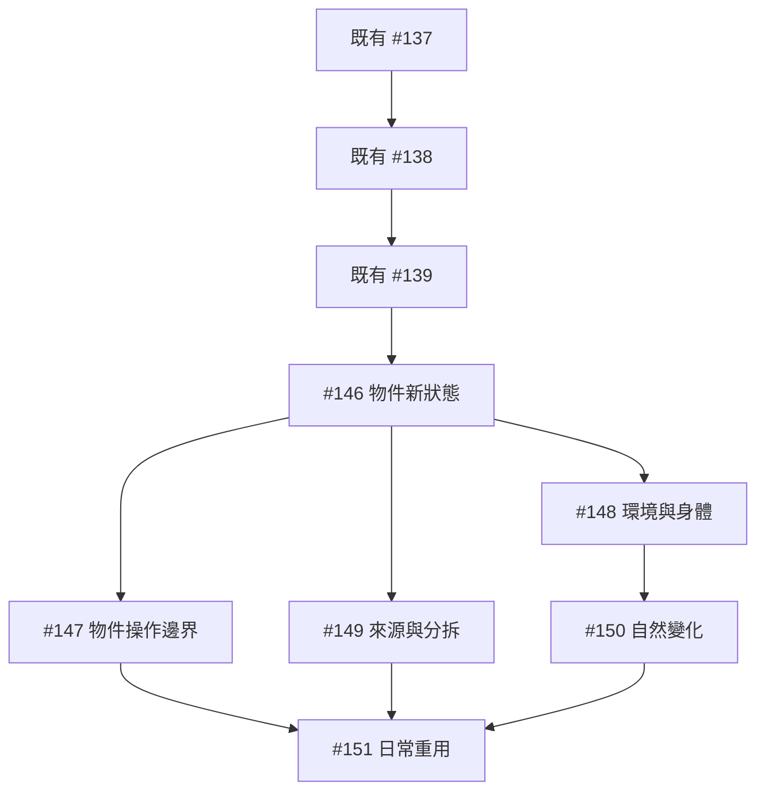

# 通用世界變更框架：工作票拆分與發布

父規格：[#145](https://github.com/sarekoubeYohane/quiet-hours-npc/issues/145)。

狀態：2026-10-21 使用者已確認六票粒度與阻擋關係，工作票 #146–#151 已發布並標記 ready-for-agent。尚未實作或驗收；父規格及既有工作票未修改或關閉。

## 查證基準與既有工作

- main：5e172d51f999f28ca17f5a207fb109d3f8c305e2；#145 完整票面已讀，留言為 0，發布前沒有新增決策或既有子票。
- [#136](https://github.com/sarekoubeYohane/quiet-hours-npc/issues/136) 及 [#137](https://github.com/sarekoubeYohane/quiet-hours-npc/issues/137) → [#138](https://github.com/sarekoubeYohane/quiet-hours-npc/issues/138) → [#139](https://github.com/sarekoubeYohane/quiet-hours-npc/issues/139) 仍 open，完整內容與前次查證一致、留言為 0。#139 的另一前置 #129 已 closed。
- 本拆分沿用這三張既有票作先行契約整理，**不新增一張重複的基礎重構票**。[#146](https://github.com/sarekoubeYohane/quiet-hours-npc/issues/146) 同時需要一般自由候選及結果分支的集中契約／無副作用解析，故以前述鏈末端 #139 作為完成前置；本計畫不另建平行契約。
- PR #144 仍 open、未合併，head 為 53f42981fb0666bc85bb91fedc963dc666eb4645。其杯子能力、有界 v2 證據與安全回饋修正已有交付，須承接並回歸，不重新發明或冒稱已在 main。可用明示的整合基線承接既有提交；本計畫不授權合併 PR。
- 原正式站已通過的餐點、店主首次泡茶、原杯與飲品保存／重讀／重送保持；#104、#106 不由本輪拆票關閉。角色表、新骰制與完整戰鬥持續延後。
- 沿用已確認的 UI＋API＋SQLite 驗收介面，不新增測試專用 UI。每票包含自身的契約、執行、保存、必要畫面、證據與回歸；[#151](https://github.com/sarekoubeYohane/quiet-hours-npc/issues/151) 有新的日常重用行為，不是單獨 QA 票。

## 拆分摘要

| 工作票 | 工作 | 直接前置 | 完成後可驗證的行為 |
| --- | --- | --- | --- |
| [#146](https://github.com/sarekoubeYohane/quiet-hours-npc/issues/146) | 自由活動承接新物件狀態與結果分支 | #139 | 從自由提案到保存重讀及畫面，承接未預列的新物件狀態與不同結果，保留同一物件身份。 |
| [#147](https://github.com/sarekoubeYohane/quiet-hours-npc/issues/147) | 分開物主許可與物理操作，保存意外及未經許可後果 | [#146](https://github.com/sarekoubeYohane/quiet-hours-npc/issues/146) | 合法借用可有意外損毀；未經許可拿取、擅用或損壞可依情境落地，持有與所有權分開。 |
| [#148](https://github.com/sarekoubeYohane/quiet-hours-npc/issues/148) | 承接環境與身體影響，連接可知線索及活動中斷 | [#146](https://github.com/sarekoubeYohane/quiet-hours-npc/issues/146) | 一次事件可改變物件、環境和身體；推拉等外在影響可保存，NPC 的意願與後續反應仍自主。 |
| [#149](https://github.com/sarekoubeYohane/quiet-hours-npc/issues/149) | 形成與轉化保留來源，分拆物件按需要細分 | [#146](https://github.com/sarekoubeYohane/quiet-hours-npc/issues/146) | 新產物保留材料來源；蛋糕數份或碎片先整體保存，分開操作時再追蹤個別部分。 |
| [#150](https://github.com/sarekoubeYohane/quiet-hours-npc/issues/150) | 已確認的自然變化隨世界時間執行並可失效 | [#148](https://github.com/sarekoubeYohane/quiet-hours-npc/issues/148) | 熱茶冷卻、濕桌面乾燥按已確認條件發生；相關條件改變時停止過期後續，無逐回合裁定。 |
| [#151](https://github.com/sarekoubeYohane/quiet-hours-npc/issues/151) | 日常規則重用通用後果，完成跨情境接續與整合驗收 | [#147](https://github.com/sarekoubeYohane/quiet-hours-npc/issues/147)、[#149](https://github.com/sarekoubeYohane/quiet-hours-npc/issues/149)、[#150](https://github.com/sarekoubeYohane/quiet-hours-npc/issues/150) | 首次日常核准保存新狀態、來源與自然變化，後續免費重用；完整同杯循環及混合情境可保存接續。 |

## 依賴與可開工範圍

- 現在的先行工作是既有 #137，接著 #138、#139；[#146](https://github.com/sarekoubeYohane/quiet-hours-npc/issues/146) 不在它們完成前另造同一契約整理。
- [#146](https://github.com/sarekoubeYohane/quiet-hours-npc/issues/146) 完成後，[#147](https://github.com/sarekoubeYohane/quiet-hours-npc/issues/147)、[#148](https://github.com/sarekoubeYohane/quiet-hours-npc/issues/148)、[#149](https://github.com/sarekoubeYohane/quiet-hours-npc/issues/149) 沒有彼此的必要行為依賴，可分別推進。[#147](https://github.com/sarekoubeYohane/quiet-hours-npc/issues/147) 處理既有物件許可與持有門檻，[#148](https://github.com/sarekoubeYohane/quiet-hours-npc/issues/148) 用無物件權限爭議的外在互動驗證新環境／身體能力，[#149](https://github.com/sarekoubeYohane/quiet-hours-npc/issues/149) 用有權或無爭議的材料驗證來源／分拆。
- [#150](https://github.com/sarekoubeYohane/quiet-hours-npc/issues/150) 需要 [#148](https://github.com/sarekoubeYohane/quiet-hours-npc/issues/148) 的環境及身體狀態／條件表示，但不必等待 [#147](https://github.com/sarekoubeYohane/quiet-hours-npc/issues/147) 的物件操作邊界或 [#149](https://github.com/sarekoubeYohane/quiet-hours-npc/issues/149) 的來源分拆。
- [#151](https://github.com/sarekoubeYohane/quiet-hours-npc/issues/151) 需 [#147](https://github.com/sarekoubeYohane/quiet-hours-npc/issues/147)、[#149](https://github.com/sarekoubeYohane/quiet-hours-npc/issues/149)、[#150](https://github.com/sarekoubeYohane/quiet-hours-npc/issues/150) 完成；[#146](https://github.com/sarekoubeYohane/quiet-hours-npc/issues/146)、[#148](https://github.com/sarekoubeYohane/quiet-hours-npc/issues/148) 及既有契約鏈已由傳遞依賴涵蓋，不重複列成直接阻擋。
- 分支工作即使沒有行為阻擋，仍需協調共用契約的變更並保持各自驗收；不為避免合併衝突就虛構額外產品依賴。
- 發布前已再次核對狀態，以下引用均已對應實際工作票。ready-for-agent 表示票面已可承接，不表示可跳過阻擋關係。

## #145 驗收覆蓋

依父規格 Acceptance criteria 的出現順序對照。共同品質條件在各票同步交付，最後再驗混合情境，沒有留到最後才補所有保存或證據。

| 父規格驗收項 | 負責票 |
| --- | --- |
| 1 新狀態與不同後果 | [#146](https://github.com/sarekoubeYohane/quiet-hours-npc/issues/146)、[#151](https://github.com/sarekoubeYohane/quiet-hours-npc/issues/151) |
| 2 完整外在影響 | [#148](https://github.com/sarekoubeYohane/quiet-hours-npc/issues/148) |
| 3 餐點與來源 | [#149](https://github.com/sarekoubeYohane/quiet-hours-npc/issues/149)；[#151](https://github.com/sarekoubeYohane/quiet-hours-npc/issues/151) 回歸 |
| 4 正常授權借還 | [#147](https://github.com/sarekoubeYohane/quiet-hours-npc/issues/147)；[#151](https://github.com/sarekoubeYohane/quiet-hours-npc/issues/151) 回歸 |
| 5 喝→洗→同杯再泡 | [#151](https://github.com/sarekoubeYohane/quiet-hours-npc/issues/151) |
| 6 意外損毀 | [#147](https://github.com/sarekoubeYohane/quiet-hours-npc/issues/147) |
| 7 未經許可物件操作 | [#147](https://github.com/sarekoubeYohane/quiet-hours-npc/issues/147) |
| 8 刻意身體影響 | [#148](https://github.com/sarekoubeYohane/quiet-hours-npc/issues/148) |
| 9 分拆與細分 | [#149](https://github.com/sarekoubeYohane/quiet-hours-npc/issues/149) |
| 10 自然變化與條件失效 | [#150](https://github.com/sarekoubeYohane/quiet-hours-npc/issues/150) |
| 11 日常免費重用與例外 | [#151](https://github.com/sarekoubeYohane/quiet-hours-npc/issues/151) |
| 12 活動與五段分支 | [#146](https://github.com/sarekoubeYohane/quiet-hours-npc/issues/146) 建立；[#147](https://github.com/sarekoubeYohane/quiet-hours-npc/issues/147)–[#150](https://github.com/sarekoubeYohane/quiet-hours-npc/issues/150) 各自情境；[#151](https://github.com/sarekoubeYohane/quiet-hours-npc/issues/151) 日常整合 |
| 13 候選／執行分離 | [#146](https://github.com/sarekoubeYohane/quiet-hours-npc/issues/146) 建立；各票對新增候選回歸 |
| 14 保存及原操作重送 | 各票針對新增變更驗證；[#151](https://github.com/sarekoubeYohane/quiet-hours-npc/issues/151) 混合情境 |
| 15 舊世界相容 | 各票處理新增表示；[#151](https://github.com/sarekoubeYohane/quiet-hours-npc/issues/151) 完整接續 |
| 16 有界證據與安全回饋 | 各票新增行為同步驗證；[#151](https://github.com/sarekoubeYohane/quiet-hours-npc/issues/151) 日常完整投影 |
| 17 真實應用回歸 | 各票端到端驗收；[#151](https://github.com/sarekoubeYohane/quiet-hours-npc/issues/151) 全場景整合 |
| 18 交付證據與限制 | 各票維護文件與審查；[#151](https://github.com/sarekoubeYohane/quiet-hours-npc/issues/151) 彙整有界驗收流程 |

## 完整工作票

以下為已發布票面；後續以各 GitHub Issue 的最新內容與留言為準。工程表示與有界上限由各票落實，驗收範圍沿用 #145。

### [#146](https://github.com/sarekoubeYohane/quiet-hours-npc/issues/146)：[世界變更] 自由活動承接新物件狀態與結果分支

#### Parent

Part of #145 — [通用世界變更框架：模型確認外在後果、物件連續性與自主邊界](https://github.com/sarekoubeYohane/quiet-hours-npc/issues/145)。

#### What to build

沿已完成的裁定契約集中化責任，打通一般自由活動的通用物件狀態變更。模型可確認未預列的茶漬、濕潤等狀態，以及相同活動在不同情境下的不同後果；候選通過後由既有活動及判定流程執行，真正保存並顯示於既有應用。

這是第一條可獨立驗收的通用世界變更路徑，先處理物件；環境／身體、形成分拆、自然變化及日常規則的新能力分別由後票接入。本票須在已確認範圍內具體化有界表示、必要一致性與版本相容，不能只加型別或放寬驗證器。

#### Acceptance criteria

- [ ] 先以真實世界 API／SQLite 重現未預列狀態或不同合理後果被現行契約拒絕，再以同一介面驗證新路徑；不把 PR #144 的新杯 dirty 能力修正重做一次。
- [ ] 模型 fixture 的新物件狀態可由正式自由活動入口保存、UI 檢視及重載，並成為後續活動可引用的條件；不要求新增同名活動處理器或預列每個值。
- [ ] 同一物件在狀態變化、移動及重載後保留身份、歸屬與來源，不暗中產生替代物；物件種類的表示可承接本票範圍，不把 food／utensil 當永久內容上限。
- [ ] 實際提示、回覆格式、解析及執行表達同一有界契約；候選解析無世界副作用，缺少必要引用、超界或矛盾候選保持拒絕，過期世界條件不能因格式合法而繞過。
- [ ] 沿既有五段判定驗證不同結果、失敗消耗及部分狀態成果；所有分支先驗證、未選分支不落地，純續做／同條件重試／原 ID 重送不另擲骰或派送。
- [ ] 新狀態能參與跨回合活動的前提檢查；前提失效停止不成立的未來效果，保留已提交成果，不提前宣告完成。
- [ ] 裁定理由、必要前後狀態及選定結果可在既有有界操作證據中核對；遮蔽、容量、截斷標示與舊證據不追補保持，NPC 僅收到自身可知結果。
- [ ] 舊物件、既有規則及記憶保持可讀與可驗證原義；覆蓋本票新增資料的重載、原 ID 重送、保存故障與版本衝突，不補造歷史或留下半套變化。
- [ ] 以真實應用 UI＋API＋SQLite 完成本票垂直驗收、適當回歸及 code review；文件明示此票已交付的範圍，其餘 #145 能力尚由後票承接。

#### Blocked by

- [#139](https://github.com/sarekoubeYohane/quiet-hours-npc/issues/139)（既有裁定契約工作；其未完成前置同樣必須完成）。

#### 驗證與邊界

沿用 #145 的真實應用 UI、世界 API 與實際 SQLite 保存重讀。NPC／裁定模型替身及受控骰子明示為 fixture；正式活動、效果、序列化、提交與重送流程不可被替換為測試捷徑。驗證外部結果及實際派送／骰子次數，不以固定台詞、HTTP 200、內部欄位名稱或私有 helper 呼叫順序當完成。

本票新增資料與行為都須有候選／執行邊界、舊世界相容、操作重送、保存失敗及有界可觀察證據的驗證；不能把這些全部留到最後一票才處理。保留既有 D20、角色自主、資訊與帳號隔離、玩家預算、派送上限及已知用量政策。角色表、新骰制、完整戰鬥、人工回溯與額外付費重試仍不在範圍內。

開始前讀取最新 main、父規格、阻擋票及留言；承接 PR #144 已存在的杯子能力、v2 證據與安全回饋修正，不重開同一缺陷票。尚未合併的提交不能當成已在 main，整合基線須明示；本票不授權合併、部署、修改正式世界或呼叫正式付費模型。不關閉 #104、#106。

#### Further Notes

2026-10-21 使用者已批准六張拆分及前置關係。本票為第 1/6 張，已發布為 ready-for-agent，尚未實作或驗收；該標籤不表示可忽略未完成前置。父規格保持原狀，不因拆票修改或關閉。

本連接器未提供原生 sub-issue／blocking 寫入工具，父規格及阻擋關係以本文 Parent／Blocked by 連結為準，未建立原生關係。

來源：[使用者確認的拆票草案](https://github.com/sarekoubeYohane/quiet-hours-npc/blob/2572a255d6a8bbd4ecce9ac887f0b2e249ae238f/docs/plans/world-changes-tickets-2026-10-21.md)。

---

### [#147](https://github.com/sarekoubeYohane/quiet-hours-npc/issues/147)：[世界變更] 分開物主許可與物理操作，保存意外及未經許可後果

#### Parent

Part of #145 — [通用世界變更框架：模型確認外在後果、物件連續性與自主邊界](https://github.com/sarekoubeYohane/quiet-hours-npc/issues/145)。

#### What to build

讓物件操作依物理可行性及裁定結果承接，物主許可保留為世界事實，但不再單獨等同所有操作都做不到。打通合法借用的意外損毀，以及刻意未經許可拿取、擅用和損壞的完整應用路徑。

更新相關物件綁定、材料／工具選擇、已知障礙、目標與效果驗證及可知回饋的共同語義。沿 [#146](https://github.com/sarekoubeYohane/quiet-hours-npc/issues/146) 的新契約與既有自由活動執行；日常規則對新語義的免費重用由 [#151](https://github.com/sarekoubeYohane/quiet-hours-npc/issues/151) 完成。本票不設計財產法律或強制 NPC 作惡。

#### Acceptance criteria

- [ ] 先重現借用者的意外損毀或未經許可操作僅因 owner／allowedTo 而被技術拒絕的案例，再從真實 API／SQLite／既有 UI 驗證新結果。
- [ ] 已自主授權的借用者可在確認的失敗分支造成損毀，保存物主、來源及後果；不用假授權或改成行動者所有來通過。
- [ ] 在可行情境下，明示 NPC／裁定 fixture 可完成未經許可拿取、擅用或損壞；持有、位置及狀態依結果改變，原所有權與未獲許可事實保留。
- [ ] 按已確認範圍承接對其他角色所持物件的外在影響；不能只解除無人持有物件的門檻就宣稱完整邊界已處理，亦不替持有者產生自願交付或接受。
- [ ] 物件引用、可達性、有限供應、生命週期、版本及帳號／世界隔離仍受檢查；不可達、已耗盡或跨世界引用的對照案例不能取得虛構成功。
- [ ] 物件綁定、工具／材料選擇、障礙與回饋不再互相沿用矛盾的許可硬門檻；合法借用的舊許可前提不成為所有新方法的永久物理障礙，也不替 NPC 自動改成偷拿。
- [ ] 正常自主授權→借杯→攜帶→洗淨→歸還的既有路徑回歸通過；口頭台詞不自動等於權威授權，持有改變不等於所有權轉移。
- [ ] 物主的意願、信念及後續選擇不被改寫；NPC 只收到可知線索和有依據的結果，不洩露隱藏權限／去向、不強制換行動。
- [ ] 本票結果及理由有有界證據，重載、同 ID 重送、保存失敗與舊世界接續保持一致；完成 UI＋API＋SQLite 驗收、適當回歸、code review 與文件更新。

#### Blocked by

- [#146](https://github.com/sarekoubeYohane/quiet-hours-npc/issues/146)：[世界變更] 自由活動承接新物件狀態與結果分支。

#### 驗證與邊界

沿用 #145 的真實應用 UI、世界 API 與實際 SQLite 保存重讀。NPC／裁定模型替身及受控骰子明示為 fixture；正式活動、效果、序列化、提交與重送流程不可被替換為測試捷徑。驗證外部結果及實際派送／骰子次數，不以固定台詞、HTTP 200、內部欄位名稱或私有 helper 呼叫順序當完成。

本票新增資料與行為都須有候選／執行邊界、舊世界相容、操作重送、保存失敗及有界可觀察證據的驗證；不能把這些全部留到最後一票才處理。保留既有 D20、角色自主、資訊與帳號隔離、玩家預算、派送上限及已知用量政策。角色表、新骰制、完整戰鬥、人工回溯與額外付費重試仍不在範圍內。

開始前讀取最新 main、父規格、阻擋票及留言；承接 PR #144 已存在的杯子能力、v2 證據與安全回饋修正，不重開同一缺陷票。尚未合併的提交不能當成已在 main，整合基線須明示；本票不授權合併、部署、修改正式世界或呼叫正式付費模型。不關閉 #104、#106。

#### Further Notes

2026-10-21 使用者已批准六張拆分及前置關係。本票為第 2/6 張，已發布為 ready-for-agent，尚未實作或驗收；該標籤不表示可忽略未完成前置。父規格保持原狀，不因拆票修改或關閉。

本連接器未提供原生 sub-issue／blocking 寫入工具，父規格及阻擋關係以本文 Parent／Blocked by 連結為準，未建立原生關係。

來源：[使用者確認的拆票草案](https://github.com/sarekoubeYohane/quiet-hours-npc/blob/2572a255d6a8bbd4ecce9ac887f0b2e249ae238f/docs/plans/world-changes-tickets-2026-10-21.md)。

---

### [#148](https://github.com/sarekoubeYohane/quiet-hours-npc/issues/148)：[世界變更] 承接環境與身體影響，連接可知線索及活動中斷

#### Parent

Part of #145 — [通用世界變更框架：模型確認外在後果、物件連續性與自主邊界](https://github.com/sarekoubeYohane/quiet-hours-npc/issues/145)。

#### What to build

擴充 [#146](https://github.com/sarekoubeYohane/quiet-hours-npc/issues/146) 的通用狀態與變更路徑，讓一次事件能同時形成物件、環境及身體的外在後果，例如打翻熱茶造成杯中茶減少、桌面濕及手被燙到。另以推開、拉住等刻意互動驗證角色身體可被外在影響，但不能藉此改寫角色自主。

將新狀態接入既有可知線索、感知／關注、活動前提及決策時機，並在既有世界／角色畫面與保存重讀中可辨識。[#147](https://github.com/sarekoubeYohane/quiet-hours-npc/issues/147) 的物件所有權門檻改造不是本票必要前置；本票可用無物件權限爭議的情境完成。

#### Acceptance criteria

- [ ] 模型 fixture 可經同一次正式活動保存物件、環境及身體變化；三者使用同一回合一致提交，UI／API／SQLite 重讀一致，不以活動敘述或 mood 代替持續狀態。
- [ ] 未預列的新環境／身體狀態可被後續活動及條件判斷引用；不以固定動作名稱或每種狀態一個專用處理器承接。
- [ ] NPC 自主提出推開／拉住等行動時，以既有判定保存外在位置／身體影響；不因受影響者未同意而一律技術拒絕，也不寫成其自願配合、原諒或指定反應。
- [ ] 實際 NPC 請求只含其可知線索；未知內情、另一角色私密記憶及觀察者裁定證據不進入輸入，既有主觀感知與認知責任保持。
- [ ] 新外在條件可使活動未來效果失效或觸發既有重新評估時機；停止不成立的後續，保留已提交成果，角色是否換事仍由既有自主流程決定。
- [ ] 以明示受控骰子驗證成功、失敗及部分身體／環境後果，不新增即時反應骰、HP、戰鬥回合或額外模型派送。
- [ ] 缺少新欄位的舊世界可接續；重載、原 ID 重送、保存故障及版本衝突不造成半套外在影響或重複事件。
- [ ] 既有世界／角色／分析入口能辨識必要狀態及有界證據，敏感資料遮蔽與舊證據不追補保持；完成本票 UI＋API＋SQLite 驗收、適當回歸、code review 及文件更新。

#### Blocked by

- [#146](https://github.com/sarekoubeYohane/quiet-hours-npc/issues/146)：[世界變更] 自由活動承接新物件狀態與結果分支。

#### 驗證與邊界

沿用 #145 的真實應用 UI、世界 API 與實際 SQLite 保存重讀。NPC／裁定模型替身及受控骰子明示為 fixture；正式活動、效果、序列化、提交與重送流程不可被替換為測試捷徑。驗證外部結果及實際派送／骰子次數，不以固定台詞、HTTP 200、內部欄位名稱或私有 helper 呼叫順序當完成。

本票新增資料與行為都須有候選／執行邊界、舊世界相容、操作重送、保存失敗及有界可觀察證據的驗證；不能把這些全部留到最後一票才處理。保留既有 D20、角色自主、資訊與帳號隔離、玩家預算、派送上限及已知用量政策。角色表、新骰制、完整戰鬥、人工回溯與額外付費重試仍不在範圍內。

開始前讀取最新 main、父規格、阻擋票及留言；承接 PR #144 已存在的杯子能力、v2 證據與安全回饋修正，不重開同一缺陷票。尚未合併的提交不能當成已在 main，整合基線須明示；本票不授權合併、部署、修改正式世界或呼叫正式付費模型。不關閉 #104、#106。

#### Further Notes

2026-10-21 使用者已批准六張拆分及前置關係。本票為第 3/6 張，已發布為 ready-for-agent，尚未實作或驗收；該標籤不表示可忽略未完成前置。父規格保持原狀，不因拆票修改或關閉。

本連接器未提供原生 sub-issue／blocking 寫入工具，父規格及阻擋關係以本文 Parent／Blocked by 連結為準，未建立原生關係。

來源：[使用者確認的拆票草案](https://github.com/sarekoubeYohane/quiet-hours-npc/blob/2572a255d6a8bbd4ecce9ac887f0b2e249ae238f/docs/plans/world-changes-tickets-2026-10-21.md)。

---

### [#149](https://github.com/sarekoubeYohane/quiet-hours-npc/issues/149)：[世界變更] 形成與轉化保留來源，分拆物件按需要細分

#### Parent

Part of #145 — [通用世界變更框架：模型確認外在後果、物件連續性與自主邊界](https://github.com/sarekoubeYohane/quiet-hours-npc/issues/145)。

#### What to build

讓實際形成與材料轉化保存必要來源、身份和數量，並完成物件分拆後按需細分的互動路徑。蛋糕切成數份或杯子成一堆碎片時，當下就保存分拆事實與重要差異；尚不需分開操作的部分可先作為整體，某部分被拿走、食用或另行使用時再細分。

本票以已獲許可或沒有物件權限爭議的情境驗收，不必等待 [#147](https://github.com/sarekoubeYohane/quiet-hours-npc/issues/147)；涉及物件本身的形成／分拆，也不必等待 [#148](https://github.com/sarekoubeYohane/quiet-hours-npc/issues/148) 的環境／身體。跨情境日常規則重用由 [#151](https://github.com/sarekoubeYohane/quiet-hours-npc/issues/151) 接入。

#### Acceptance criteria

- [ ] 餐點取得／食用及必要形成、材料轉化經正式活動留下可追蹤來源；可承接多來源關聯，不把新產物和復活舊物件混為一談。
- [ ] 分拆發生時即保存原物改變、份量及來源，不等到有人拿取才補造歷史；已有重要差異的部分保留可辨識性。
- [ ] 某份被拿走、藏匿、使用或食用時可獨立追蹤，剩餘整體相應更新；不保留可重用的完整原物再加上全部分拆成果，也不因細分複製已消耗部分。
- [ ] 杯子單純喝完、清洗或攜帶仍保留原身份，不誤用分拆或形成產生替代物；真正新成果有來源，已損毀／消耗物件不復生。
- [ ] 日常背景與明確有限供應並存；明示最後一份等稀缺事實保持，不能以背景或新規則補回耗盡物資。
- [ ] 轉化／合成不抹掉來源、擅自轉移所有權或補出同意；來源與數量一致性、必要資料上限由可機械驗證的契約保護，不引入完整財產或物理化學模擬。
- [ ] 結果分支、失敗消耗、部分產物及未選分支正確；無效候選不留下材料扣除或半套新物，原 ID 重送及重載不再次形成或細分。
- [ ] 舊單一來源物件保持可讀及原義，保存失敗／版本衝突保持一致；既有 UI／API 可核對來源、餘量及必要身份，有界證據及資訊隔離保持。
- [ ] 完成本票 UI＋API＋SQLite 驗收、適當回歸、code review 及文件更新，不把數量單位、欄位命名或私有函式位置當成產品驗收。

#### Blocked by

- [#146](https://github.com/sarekoubeYohane/quiet-hours-npc/issues/146)：[世界變更] 自由活動承接新物件狀態與結果分支。

#### 驗證與邊界

沿用 #145 的真實應用 UI、世界 API 與實際 SQLite 保存重讀。NPC／裁定模型替身及受控骰子明示為 fixture；正式活動、效果、序列化、提交與重送流程不可被替換為測試捷徑。驗證外部結果及實際派送／骰子次數，不以固定台詞、HTTP 200、內部欄位名稱或私有 helper 呼叫順序當完成。

本票新增資料與行為都須有候選／執行邊界、舊世界相容、操作重送、保存失敗及有界可觀察證據的驗證；不能把這些全部留到最後一票才處理。保留既有 D20、角色自主、資訊與帳號隔離、玩家預算、派送上限及已知用量政策。角色表、新骰制、完整戰鬥、人工回溯與額外付費重試仍不在範圍內。

開始前讀取最新 main、父規格、阻擋票及留言；承接 PR #144 已存在的杯子能力、v2 證據與安全回饋修正，不重開同一缺陷票。尚未合併的提交不能當成已在 main，整合基線須明示；本票不授權合併、部署、修改正式世界或呼叫正式付費模型。不關閉 #104、#106。

#### Further Notes

2026-10-21 使用者已批准六張拆分及前置關係。本票為第 4/6 張，已發布為 ready-for-agent，尚未實作或驗收；該標籤不表示可忽略未完成前置。父規格保持原狀，不因拆票修改或關閉。

本連接器未提供原生 sub-issue／blocking 寫入工具，父規格及阻擋關係以本文 Parent／Blocked by 連結為準，未建立原生關係。

來源：[使用者確認的拆票草案](https://github.com/sarekoubeYohane/quiet-hours-npc/blob/2572a255d6a8bbd4ecce9ac887f0b2e249ae238f/docs/plans/world-changes-tickets-2026-10-21.md)。

---

### [#150](https://github.com/sarekoubeYohane/quiet-hours-npc/issues/150)：[世界變更] 已確認的自然變化隨世界時間執行並可失效

#### Parent

Part of #145 — [通用世界變更框架：模型確認外在後果、物件連續性與自主邊界](https://github.com/sarekoubeYohane/quiet-hours-npc/issues/145)。

#### What to build

把天上意志在確認外在後果時一併提出的自然變化、時間與成立條件，接入真實世界時間推進與保存。以熱茶冷卻及濕桌面乾燥示範從首次確認到時間推進、UI 顯示、保存重讀及條件失效的完整路徑。

沿既有活動／世界推進與回合一致性責任執行，不另建付費背景輪詢或只存在於前端的計時器。依賴 [#148](https://github.com/sarekoubeYohane/quiet-hours-npc/issues/148) 提供物件以外的狀態與條件引用；不要求先完成 [#147](https://github.com/sarekoubeYohane/quiet-hours-npc/issues/147) 的物件許可或 [#149](https://github.com/sarekoubeYohane/quiet-hours-npc/issues/149) 的分拆來源功能。

#### Acceptance criteria

- [ ] 天上意志在既有有界裁定內確認後果時，一併確認必要的自然變化、時間與相關條件；候選解析不安排或執行世界變化。
- [ ] 世界時間到達且條件持續成立時，冷卻／乾燥等後果經正式推進與保存發生，既有 UI、API 及 SQLite 重讀一致。
- [ ] 自然變化推進不新增裁定或擲骰；NPC 決策仍按既有時機另計，不把整回合模型數誤稱零。
- [ ] 相關條件途中改變時停止不再成立的後續；不因無關世界變動使全部安排失效，必要的新情境裁定仍受既有 slot／預算限制。
- [ ] 同時存在活動階段與自然變化時按一致的世界時間及前提處理，保留已提交成果；不套用過期狀態、提前完成活動或依計時器重做效果。
- [ ] 安排、進度與必要條件可保存重載；原 ID 重送、提交前失敗、提交不明及版本／租約衝突不漏做或重複執行，已知用量保持。
- [ ] 時間、條件數量、資料與推進成本有具體有界方案；無效／矛盾候選及容量情境沿既有失敗分類處理，不偷偷補呼叫、修復格式或追溯補造舊世界安排。
- [ ] 既有分析可查看有界的確認與執行／失效證據，NPC 只取得可知後果；完成 UI＋API＋SQLite 驗收、適當回歸、code review 及文件更新。
- [ ] 本票不新增離線常駐運行、主動天氣／新客人、人工回溯、角色表、新骰制或戰鬥系統。

#### Blocked by

- [#148](https://github.com/sarekoubeYohane/quiet-hours-npc/issues/148)：[世界變更] 承接環境與身體影響，連接可知線索及活動中斷。

#### 驗證與邊界

沿用 #145 的真實應用 UI、世界 API 與實際 SQLite 保存重讀。NPC／裁定模型替身及受控骰子明示為 fixture；正式活動、效果、序列化、提交與重送流程不可被替換為測試捷徑。驗證外部結果及實際派送／骰子次數，不以固定台詞、HTTP 200、內部欄位名稱或私有 helper 呼叫順序當完成。

本票新增資料與行為都須有候選／執行邊界、舊世界相容、操作重送、保存失敗及有界可觀察證據的驗證；不能把這些全部留到最後一票才處理。保留既有 D20、角色自主、資訊與帳號隔離、玩家預算、派送上限及已知用量政策。角色表、新骰制、完整戰鬥、人工回溯與額外付費重試仍不在範圍內。

開始前讀取最新 main、父規格、阻擋票及留言；承接 PR #144 已存在的杯子能力、v2 證據與安全回饋修正，不重開同一缺陷票。尚未合併的提交不能當成已在 main，整合基線須明示；本票不授權合併、部署、修改正式世界或呼叫正式付費模型。不關閉 #104、#106。

#### Further Notes

2026-10-21 使用者已批准六張拆分及前置關係。本票為第 5/6 張，已發布為 ready-for-agent，尚未實作或驗收；該標籤不表示可忽略未完成前置。父規格保持原狀，不因拆票修改或關閉。

本連接器未提供原生 sub-issue／blocking 寫入工具，父規格及阻擋關係以本文 Parent／Blocked by 連結為準，未建立原生關係。

來源：[使用者確認的拆票草案](https://github.com/sarekoubeYohane/quiet-hours-npc/blob/2572a255d6a8bbd4ecce9ac887f0b2e249ae238f/docs/plans/world-changes-tickets-2026-10-21.md)。

---

### [#151](https://github.com/sarekoubeYohane/quiet-hours-npc/issues/151)：[世界變更] 日常規則重用通用後果，完成跨情境接續與整合驗收

#### Parent

Part of #145 — [通用世界變更框架：模型確認外在後果、物件連續性與自主邊界](https://github.com/sarekoubeYohane/quiet-hours-npc/issues/145)。

#### What to build

把前票已可在自由活動中執行的通用狀態、許可／物理邊界、來源／分拆及自然變化接到日常規則的首次核准、當前綁定和後續免費重用。完成新活動可引用與重用這些後果的完整路徑，而非只補一張整合 QA 票。

以同杯喝→洗→再次泡茶及代表性跨功能情境驗證新日常契約：條件相符不重問，真正例外走既有有界裁定；新舊規則各保持可驗證範圍。最後彙整本規格的回歸、code review、限制及部署後有界驗收流程。

#### Acceptance criteria

- [ ] 首次日常核准在同一次有界裁定確認適用範圍、必要背景、耗時、階段及結果分支，可保存前票支援的新狀態、必要來源／份量和自然變化；不是只把核准文字存起來。
- [ ] 後續相符的新活動重新綁定當前物件／數量／版本並完成，新增裁定為 0；NPC 決策另計，不永久沿用首次骰子或具體成果，也不新增匹配／分類模型。
- [ ] 喝茶→清洗→同杯再次泡茶保持原杯身份，前次飲品消耗、新飲品來源及數量正確；同活動可有模型確認的不同合理後果，不再以唯一 drink／wash 固定值替模型決定。
- [ ] 相關新狀態、份量、持有或身體／環境條件改變時，規則及未來效果按當前前提處理；無關狀態不讓整組規則失效。必要例外及已知障礙恢復可接續，不洗骰或反覆同義裁定。
- [ ] 合法借用的既有規則保持其範圍；未獲許可的新方法可由新契約承接，不能被舊許可障礙永久封死，也不把詢問或借用意圖自動改成偷拿。
- [ ] 新日常規則在分拆產物、外在身體／環境影響及自然變化的代表性組合中，可完成保存重讀與跨回合接續；未選分支不殘留供應、產物或排程。
- [ ] 覆蓋既有五段結果、失敗消耗、部分成果、純續做、自主中斷及物理前提失效；前階段成果保留，各既有入口及直接控制遵守原派送界線。
- [ ] 舊世界、舊規則及歷史證據保持原義及可讀，相關新行動可取得新能力；不重置、補造新確認或於讀取時付費重建。無法安全相容時須具體提出影響，不默默遷移或丟失活動。
- [ ] 完整 UI＋API＋SQLite 情境覆蓋餐點、正常授權借還、同杯循環、未經許可後果、分拆、自然變化及原 ID 重送；保存前失敗、提交不明及版本／租約衝突不重複派送／骰子／效果，既有用量及成果保持。
- [ ] 有界操作證據能判定首次核准、階段、選定結果與新後果；敏感資料遮蔽、截斷／淘汰及舊證據不追補保持，NPC 回饋不洩漏隱藏理由或強制換行動。
- [ ] 完成適當回歸、code review 與必要設計／ADR 狀態更新；交付可直接執行的部署後有界驗收流程，明示部署版本、既有預算、回合／時間上限及停止條件。
- [ ] 報告分開列出 fixture 通過、尚未到達與正式站既有結果；不呼叫正式付費模型、不以 fixture 宣稱正式站通過，不關閉 #104／#106，不自行合併或部署。

#### Blocked by

- [#147](https://github.com/sarekoubeYohane/quiet-hours-npc/issues/147)：[世界變更] 分開物主許可與物理操作，保存意外及未經許可後果。
- [#149](https://github.com/sarekoubeYohane/quiet-hours-npc/issues/149)：[世界變更] 形成與轉化保留來源，分拆物件按需要細分。
- [#150](https://github.com/sarekoubeYohane/quiet-hours-npc/issues/150)：[世界變更] 已確認的自然變化隨世界時間執行並可失效。

#### 驗證與邊界

沿用 #145 的真實應用 UI、世界 API 與實際 SQLite 保存重讀。NPC／裁定模型替身及受控骰子明示為 fixture；正式活動、效果、序列化、提交與重送流程不可被替換為測試捷徑。驗證外部結果及實際派送／骰子次數，不以固定台詞、HTTP 200、內部欄位名稱或私有 helper 呼叫順序當完成。

本票新增資料與行為都須有候選／執行邊界、舊世界相容、操作重送、保存失敗及有界可觀察證據的驗證；不能把這些全部留到最後一票才處理。保留既有 D20、角色自主、資訊與帳號隔離、玩家預算、派送上限及已知用量政策。角色表、新骰制、完整戰鬥、人工回溯與額外付費重試仍不在範圍內。

開始前讀取最新 main、父規格、阻擋票及留言；承接 PR #144 已存在的杯子能力、v2 證據與安全回饋修正，不重開同一缺陷票。尚未合併的提交不能當成已在 main，整合基線須明示；本票不授權合併、部署、修改正式世界或呼叫正式付費模型。不關閉 #104、#106。

#### Further Notes

2026-10-21 使用者已批准六張拆分及前置關係。本票為第 6/6 張，已發布為 ready-for-agent，尚未實作或驗收；該標籤不表示可忽略未完成前置。父規格保持原狀，不因拆票修改或關閉。

本連接器未提供原生 sub-issue／blocking 寫入工具，父規格及阻擋關係以本文 Parent／Blocked by 連結為準，未建立原生關係。

來源：[使用者確認的拆票草案](https://github.com/sarekoubeYohane/quiet-hours-npc/blob/2572a255d6a8bbd4ecce9ac887f0b2e249ae238f/docs/plans/world-changes-tickets-2026-10-21.md)。

## 發布紀錄與本次邊界

使用者已於 2026-10-21 回覆「ok」，批准六張拆分、驗收範圍及前置關係；依 to-tickets 流程按依賴順序建立 #146–#151，套用 ready-for-agent，完整票面已回讀確認。

目前 GitHub 連接器沒有原生 sub-issue／blocking 寫入工具，各票以 Parent／Blocked by 明確連結父規格及阻擋票；未建立原生關係。父規格 #145 與既有票保持原狀，不因拆票修改或關閉。

先行工作仍為既有 #137 → #138 → #139，再開始 #146。#146 完成後 #147、#148、#149 可分別推進；#148 完成後可進行 #150；#147、#149、#150 完成後進行 #151。ready-for-agent 不表示可跳過未完成前置。

本次僅發布工作票並更新拆分文件，沒有執行功能測試、啟動 runtime 實作、呼叫正式付費模型、修改正式世界、合併或部署；#104、#106 保持未關閉。
