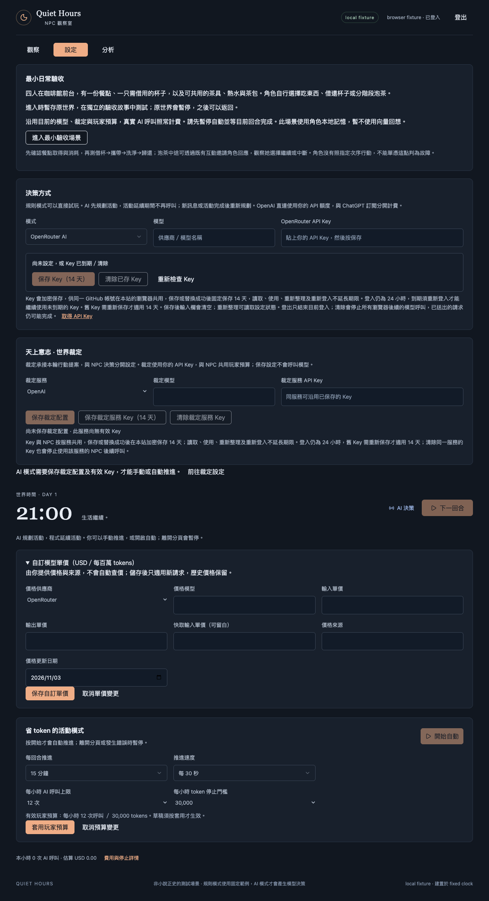
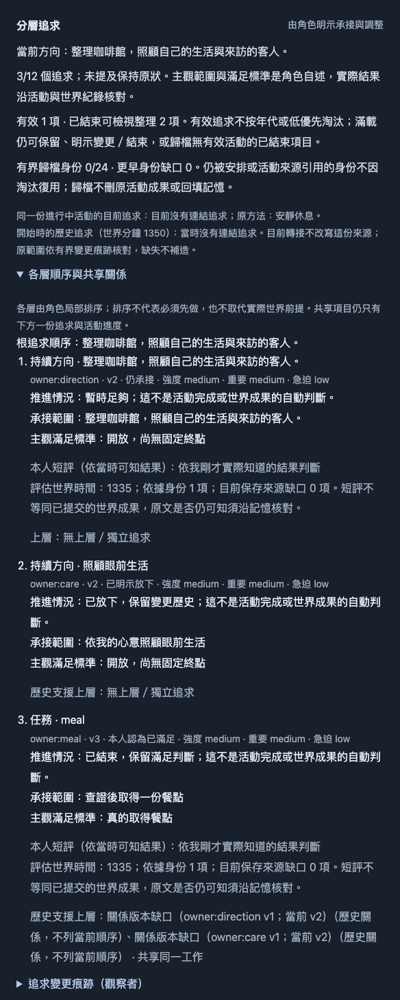
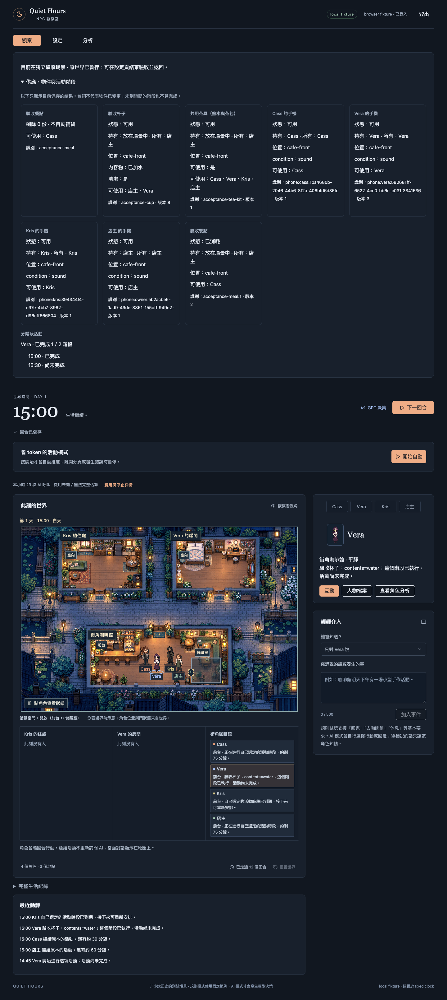

# 2026-11-03 現行規格回歸

最終：**1117/1117 預設測試、78/78 瀏覽器入口，加上實體 SQLite 重開唯讀 UI 1/1**；型別、完整及 CI 指定 lint、兩環境建置與設定守門通過。完整 lint 保留4項既有warning。修正一處自由提案可知語境缺口，最終runtime差異僅一行條件，沒有資料migration。

程式提交 **1fae637**；完整tree與實際瀏覽器測試提交 **373e019** 相同（`99e1adf27f712c26e2409ee107abc0da48e5ffd7`）。本機Node26結果不代替PR上的Node24 CI。條款層級及真人／正式證據仍有下列缺口，因此不宣稱所有spec通過。

## 驗證版本與隔離

以台北時間 2026-11-03 擷取的 `origin/main` **9c7c2d0** 為基準（完整 SHA 以 `results.json` 為準）。原 checkout 位於 `quiet-hours-npc`，分支 `fix/model-key-retention-14-days`、HEAD `8e4b846`，保留未追蹤 `artifacts/`；其 tree 與當時最新 main 相同，差別是 main 多了 PR #231 的合併提交。獨立 worktree 為 `../quiet-hours-npc-regression-20261103`、分支 `verify/spec-regression-20261103`。沒有部署、合併、正式世界操作、真實模型 Key 或付費派送。

環境為 macOS、Node 26.5.0、pnpm 11.25.0；CI 使用 Node 24，故本機通過不能代替同提交 CI。沿用原 lockfile 與既有 `node_modules`（以 worktree symlink 讀取），沒有修改依賴或安裝產品套件。Playwright 單獨安裝在 `/private/tmp/npc-regression-browser`，使用本機無頭 Google Chrome 156.0.8078.80、Playwright 1.64.1。依據 `AGENTS.md`、Matt Pocock implement → TDD → code-review 及 PR 格式執行；需求與測試邊界已由使用者授權，沒有重新 grilling 或開票。

## 現行來源與取代關係

[來源清單及 SHA256](source-inventory.csv) 收錄 README、GLOSSARY、全部 `docs/design`／`docs/adr` 共 **66** 個來源；[條款抽取](clause-audit.csv) 保存文件段落與相關 Issue 驗收行的來源位置。後者是可追溯的盤點及候選測試索引，**不是 2825 條要求已逐一通過的證明**：含術語、背景、重複引用及已取代段落；未確認到單一斷言的列保留未核狀態，不以所屬測試群全綠自動填成通過。

以 GitHub API 唯讀盤點全 repo 231 個 Issue／PR 共用編號的項目、75 份 PR，以及有後續留言的規格。原件留在本機 `artifacts/regression-20261103`，不提交未篩選留言／私人追溯。來源連結以 `sarekoubeYohane/quiet-hours-npc` 為準。

| 原條款／快照 | 現行判定 |
| --- | --- |
| #19／#26 的工作階段綁 Key、登出刪除、跨裝置重填 | 由 2026-10-09 帳號／環境共用修訂取代。 |
| #26 原 24 小時 Key 保存期 | 由 PR #231、2026-11-03 `account-model-keys.md` 改為保存／替換後固定 14 天；登入仍 24 小時，舊 Key 原期不變。 |
| #1 平面 intents 全陣列、省略即退出；#67 v1／#195 v2 NPC wire | 由 #220、ADR0009 及 PR #230 的 v3 明示增量、候選／收斂、唯一分層追求取代。 |
| #115 的一般活動 90 分鐘界限 | #172／#175–#177 的有限長活動、可暫停及真正睡眠承接；HTTP 期限獨立。 |
| #24／#77 歷史 120／125 秒政策 | #168 的 400 秒工作、430 秒租約、445 秒前端等待與 `round-v1` 受理守門。 |
| #109–#151 初始實作時的狀態快照 | 依後續 #186／#194–#201、#205／#206–#210 的方法、已知狀態、來源範圍、探索與身體後果修訂判定。 |
| #194 主觀回饋與已知物件 | 公開狀態可以重述，**不等於已確認它是本次受阻原因**；隱藏庫存／許可 A/B 不可改變角色可見回饋。 |
| README 2026-10-21「待合併／待實作」表 | 保留歷史；PR #131／#144／#152／#182／#202–#204／#212–#216／#219／#230 已合併的程式，以後續設計及本次實測為準。Issue 保持 open 不代表全部未實作。 |

## 證據分級

- **F：受控 transport／API**。真路由、活動、感知、效果、JSON 與 SQLite；OAuth、host binding、模型 transport、必要時鐘／骰為替身。可證明程式契約，不能證明模型會自主選同樣行動。
- **L：本機瀏覽器整合**。真 WorldApp → HTTP → 真 GET/POST handler → SQLite → 重載／原 ID 重送；初始場景、登入及模型回覆仍為明示 fixture。不是只 mock HTTP 回應。
- **W：Miniflare／workerd**。真 Workers Request、D1、AES-GCM；外部 HTTP／OAuth 是受控邊界，`outboundService` 拒絕外網。
- **H／P：真人、正式環境**。本輪沒有取得新證據；既有歷史報告只作背景，不代替本次版本的驗收。

所有預設測試由 `tests/run-tests.mjs` 自動 preload `no-network.mjs` 並傳給子程序；個別 runner 明確使用 `NODE_OPTIONS="--import=$PWD/tooling/verification/no-network.mjs"`。不刪除失敗、不放寬格式、時限、預算或斷言以求綠燈。

## 執行命令與結果

測試標題索引有32個動態名稱尚未唯一對應靜態定義位置；保留原執行標題與PASS，沒有偽填來源。條款抽取中153段尚無獨立方法映射，2297段只有測試群／旅程證據候選，375段為背景／術語；這些分類不是現行要求總數。

最終數目、各 runner 命令／exit code／耗時及相應合成證據 hash 見 [results.json](results.json)、[browser-results.json](browser-results.json) 與 [test-index.csv](test-index.csv)。每組測試重跑不累加成獨立覆蓋數。完整本機 stdout 留在 `artifacts/regression-20261103/logs/`；提交的摘要只保留固定狀態、測試標題與合成證據。

| 命令 | 目的／本次結果 |
| --- | --- |
| `git fetch origin main`、`git rev-parse HEAD origin/main`、雙向 `git log`／`git diff --stat` | 初次 DNS 受沙箱阻擋；必要網路權限後成功更新 main 至 9c7c2d0，確認原 tree 相同。 |
| `git worktree add ../quiet-hours-npc-regression-20261103 -b verify/spec-regression-20261103 origin/main` | 新建隔離工作區，沒有覆蓋原 checkout。 |
| `pnpm test`（基線） | 世界／活動 1042/1042、auth 37/37 通過；原生組 13/15，兩項 Workers 因 EPERM loopback 無法啟動，runner 組未執行，不能稱整套通過。 |
| `NODE_OPTIONS=… node --test tests/auth-workerd.test.mjs tests/model-keys-workerd.test.mjs`（必要本機權限） | 2/2 通過，保留 outboundService 與 no-network；不是跳過 Workers。 |
| `NODE_OPTIONS=… node tests/run-activities.mjs tests/routine-obstacles-api.test.cjs` | 新自由提案案例先 RED；加入未知／hidden／隱藏目標旁有可見損壞杯的反例。 |
| `NODE_OPTIONS=… node tests/run-activities.mjs tests/action-feedback-api.test.cjs` | 中間修法被既有隱藏庫存 A/B 相等性推翻；保留完整 RED，沒有改掉原斷言。 |
| `NODE_OPTIONS=… node tests/run-activities.mjs tests/action-feedback-api.test.cjs tests/routine-obstacles-api.test.cjs` | 最終最小修法 22/22 通過，新增區域提案 A/B 對照與原矩陣均保留。 |
| `pnpm test`（最終產品修復後、必要本機權限） | 結果以 results.json 為準；所有四個預設分組均須實際執行，不能用上述選定測試代替。 |
| `pnpm typecheck`、`pnpm lint` | 型別通過；完整 lint 0 errors、保留原 4 warnings（3 img、1 useEffect dependency）。 |
| `.github/workflows/npc-world-checks.yml` 中原樣 `pnpm exec eslint …` 清單 | CI 指定 lint 清單實際執行；變更 browser runner 另納入完整 lint。 |
| `pnpm build:production`＋CI 的設定斷言 | 實際建置、檢查 Worker 名稱／APP_ENV；沒有 deploy。 |
| `pnpm build:test`＋`node tooling/check-test-build.mjs dist/server/wrangler.json` | 實際測試環境建置及 D1／origin／logging/source-map 守門；沒有遠端 migration／部署。 |
| `node tooling/experiments/check-autonomous-demand-211.mjs`、`node tooling/experiments/pursuit-runner-228.mjs` | #211檢查回exit2：目前checkout不等於其封存舊提交，正確拒絕，材料未改；#228預檢exit0但paidReady=false，缺授權、價目與封存版本。完整套件的13項checker/migration及兩Workers仍實際通過。沒有probe真Key。 |
| `PLAYWRIGHT_MODULE=… CHROMIUM_EXECUTABLE=… BROWSER_ARTIFACT_DIR=… NODE_OPTIONS=… node tooling/verification/<runner>.mjs` | 每支命令、環境變體與 exit code 在 browser-results.json；包含 #127 七分支、#129 六分支、#151 八情境及 `TEA_ACTION=legacy`。 |
| `git diff --check` | 提交前內容／空白守門。 |

曾有一個冗餘中間版本套件在最終版本開始後停止，沒有計為通過。另一中間修法完整世界組為 1043 項中 1042 通過、1 失敗；該失敗正是隱藏回饋 A/B，後續 auth／Workers／runner 未執行，沒有混算為最終結果。所有失敗與環境阻擋都留存。

[規格群對照及跨功能結果](coverage.md)另外列出每群實際方法、證據邊界與未覆蓋部分。

## 本次產品修復及 review

自由提案對場所／區域詢問日常活動時，原 `recordActionResult` 只保留精確 target／本人持有物件；不像舊 `work/tea` 路徑附帶已知器具狀態，造成同樣可見損壞杯在自由提案後消失於回饋語境。最終只擴充既有 `knownWorldObjects` 的 relevant 選取一行，沿原 4 物件／1024 bytes 限制，保留原因未知；不查看庫存、許可或裁定私有原因。

初版曾將可見損壞提升為 `knownBlockedReason`。兩軸 review 先抓到隱藏目標與無關公開杯的身份借道，補反例後，完整套件再抓到材料優先分支造成的 A/B 差異。因此**原原因提升修法已全部撤回**，`routine-obstacles.ts`／`routine-rules.ts` 相對基準無改動；不能把中間 GREEN 當作最終修法證據。

最終 API 包含可知、未知、hidden、指定 hidden 杯旁另有公開損壞杯，以及公開狀態相同、私有庫存／許可不同的嚴格 A/B 相等對照。兩軸獨立 review 對最終 `lib/tests` diff 無剩餘發現；驗證工具 review 抓到的初始化誤改與非對稱 replay 投影均已修正，仍比較完整保存物件陣列。

瀏覽器工具修復在作者位置明示 v3 fixture，而非 interceptor 自動修回覆；同步 `round-v1`、明示裁定耗時、手機共存、nested action、430 秒租約、模型設定前置、同一 fixture 時鐘與兩個 Key 欄位。所有 runner 尊重獨立輸出目錄，不提交被重生覆蓋的歷史截圖。`browser83` 的樣本老化測試只推觀察者時鐘，保持伺服器租約有效；釋放成功後明示暫停／恢復，再完成兩回合重採樣，並非無需重啟的自動恢復證據。伺服器超期另由故障旅程驗證，避免要求已過 430 秒的請求還能成功。

## 尚未驗證／非回歸失敗

| 類別 | 項目與原因 |
| --- | --- |
| 尚未實作設計 | #27 每日跨環境帳本、#29 伺服器共用排程、#31 正式發布／回復完整流程、#32 交接及 #70–#72／#75 尚未交付部分；#62／#76／#158／#183 為探索。沒有因其未實作直接宣告回歸失敗。 |
| 真人／部署後 Key | 真 OAuth、真正兩瀏覽器登入、測試／正式跨環境秘密與 migration 配置、有效真 Key；本輪禁止真 Key／正式操作，因此只有 F/L/W 程式證據。 |
| 真實模型行為 | #85／#104／#106、#205／#211、#220／#229 的多輪自主選擇、loop 改善、候選品質／真正承接及退出；fixture 不能證明，沒有付費呼叫。 |
| 平台／事故 | #77 最初中斷的 HTTP／Worker／D1 根因、CPU／遠端延遲及正式完整回合包絡；本機受控時間不量測平台表現。 |
| 外部服務 | 正式 Vectorize 精確版本可查性、Embedding 價目／預算及服務 smoke；本地 recall fixture 不代表資源已配置或可用。 |
| 相容／回退 | 已執行舊世界可讀、明示 reset、舊 Key 原期、journal 重放及新語義保留的反例；沒有實際回退正式 binary／資料。 |
| 條款層級缺口 | clause-audit.csv 中未逐一核對到有效斷言的段落仍保留待核；family 測試／瀏覽器通過不自動證明該 family 每句規格。H/P 條款不得改列 F/L 通過。 |

本報告不宣稱「所有 spec 通過」。已執行項目、有效證據與尚缺的證據分開記錄；新的正式／真人驗收仍需其實際證據，不能從歷史報告或合成回覆推定。

## 篩選合成畫面

