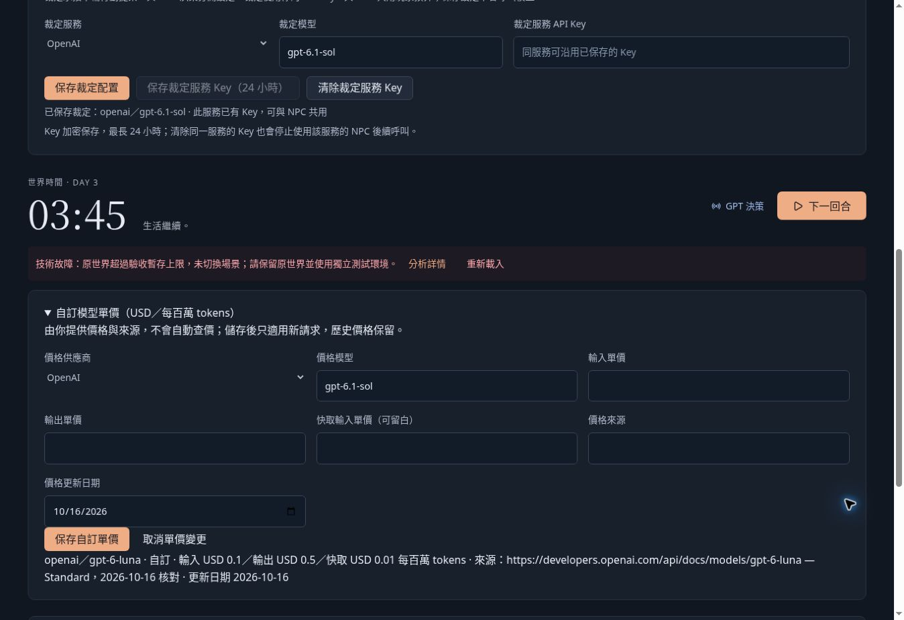

# 最小驗收場景正式站複測

日期：2026-10-16（Asia/Taipei），使用者 21:53 要求合併後再測。正式站版本 `d18ce8a`（PR #102 合併提交），頁面顯示建置於 21:18。

## 結果：被原世界暫存容量阻擋

真實已登入正式站、真實 UI 操作；沒有以本機 fixture 代替正式站驗收。先測取消進入，再選 OpenAI／GPT-6.1 Sol（裁定既有配置同為 Sol），確認進入後，頁面顯示：

> 技術故障：原世界超過驗收暫存上限，未切換場景；請保留原世界並使用獨立測試環境。

`lib/acceptance-scene.ts` 對去除共用用量、裁定、預算、價格後的原世界 JSON 設 512 KiB 上限；本次正式世界觸發此拒絕分支。沒有讀取正式資料庫、沒有取得實際 JSON byte 數，不能進一步宣稱超出多少或由哪一欄造成。

| 核對項目 | 進入前 | 失敗後重載 |
| --- | --- | --- |
| 世界 | 第 123 回合，D3 03:45 | 第 123 回合，D3 03:45 |
| 位置／活動 | Cass、Kris 在 Kris 住處；Vera 在房間；店主在前台，均休息 | 可見內容相同 |
| 累計 AI 呼叫 | 284 | 284 |
| 本小時呼叫／tokens | 0／0 | 0／0 |
| 累計已知費用小計 | USD 0.04067623，另有 233 次費用資料不完整 | 相同 |
| 自動運行 | 暫停 | 暫停 |

進入確認前已測取消，未切換世界或派送模型。失敗後 pending 已清除、按鈕恢復可用；重新載入正常讀回原世界。頁面重載依既有行為回到規則試玩，沒有自動續跑。

## 未測到的場景

餐點取得／消耗、店主授權與借還杯子、泡茶階段／中斷、成功進入後返回，都因無法進入場景而未執行。新增付費模型呼叫為 0，不能宣稱真實模型行為驗收通過。沒有重置、裁切或覆寫原世界，也沒有提高預算或修改部署。

## 後續修正方向

512 KiB 的有界備份保護按設計生效，但此設計無法服務本次既有正式世界，構成驗收入口的實際阻擋。應先評估原世界及含備份根列的容量與儲存限制，再決定調整有界容量或將原世界與驗收世界分開保存；保留原子切換、重載／返回、跨分頁與已付用量契約。不可透過刪除記憶或重置玩家世界來完成驗收。

