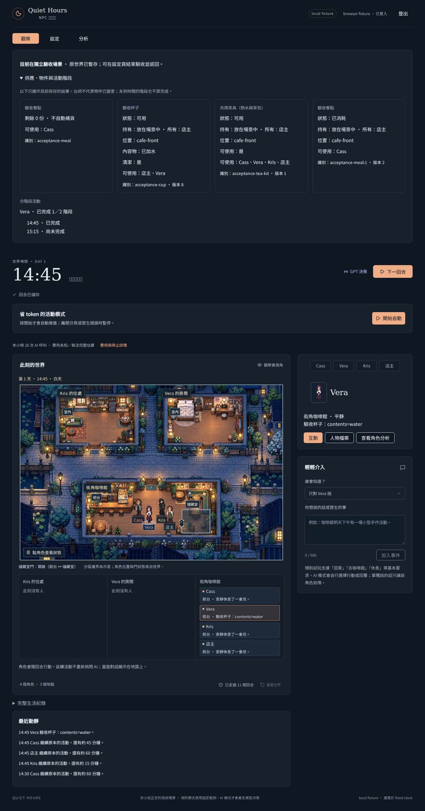

# 最小日常驗收場景驗證

日期：2026-10-16，台北。基準 main：`a1c3900746d3adbb42be9360d58386bc33d5f168`（PR #101 已合併）。來源需求：本輪「補最小驗收場景」，契約見 [場景設計](../design/minimal-acceptance-scene.md)。

## 已實作

- 設定頁確認進入獨立驗收故事，沿同一世界租約、版本及 operationId 保存一份原世界；可重載繼續或確認結束返回。
- 場景只有一份有限餐點、一只店主所有且需自主授權的杯子、明示可用的茶具／熱水／茶包。四角色保留性格，自主決定行動，不修改正式世界供應或小說設定。
- 模型／裁定配置、Key、價格、玩家預算及真實用量共用；原世界的事件、角色、物件、活動與時間暫停並可返回。返回保留驗收已付用量，不取得新額度。
- 原世界快照有 512 KiB 上限，僅保存於原子世界列；API 與操作回覆不含快照。驗收分支停用向量回想，避免更動原世界索引。
- 新情境識別隔離跨分頁舊操作；已結案操作仍重播原結果，未知舊操作拒絕並重新讀取。驗收期間禁止一般重置。
- 可展開檢查供應剩餘、物件身份／持有／所有／生命週期／狀態，以及已完成與尚未完成的活動階段。

## 實際 Red → Green

1. 新世界 API 驗收最初 `enter-acceptance` 回 HTTP 400「無效操作」，1／1 失敗。接線後成功進入、取得／食用並返回原世界。
2. 增加真正早於切換時間的舊分頁操作，原本先回 HTTP 410，造成一般過期處理留住未完成操作。將情境比對放在未知操作的到期檢查前（仍在已結案／pending 判定後），現在 HTTP 409 `contextMismatch`，瀏覽器清除這個未被接受的操作並讀回新場景；不重派或套用舊意圖。

## 驗證結果

- 定向 `tests/acceptance-scene-api.test.cjs`：6／6 通過。涵蓋餐點取得／消耗／重讀／返回、玩家預算與已付用量、重播、保存衝突、提交後回覆遺失、快照容量、跨帳號、原世界私密內容隔離、借杯／攜帶／洗淨／歸還與泡茶中斷、驗收分支回想隔離。
- 真實 Chromium／WorldApp／GET＋POST／SQLite：`browser-acceptance-scene.mjs` 五組 PASS，無 pageerror。取消進入／返回、過期舊分頁的恢復、餐點兩回合後同一物件已消耗、店主自主 grant、借杯→攜帶→洗淨→歸還、空杯→中間水→中斷保留水、返回原世界與保留用量均由真實 UI 操作及 GET 重讀確認。
- 桌機 1440px 及窄版 390px 已目視檢查；390px 無橫向溢出。截圖中的模型與身份均為 fixture，非玩家世界或 Key。
- TypeScript 通過；變更檔 ESLint 0 errors，WorldApp 有 1 項原有 `act` effect dependency warning。
- 完整 `pnpm test`：296／296 通過（世界／活動 254、身份／API 32、Workers／D1／遷移 10）。首次完整回歸發現 Workers 手動模組清單漏載新模組；補入後，該項定向測試及完整重跑均通過。
- `pnpm build:production` 成功；輸出 worker 名稱 `quiet-hours-npc`、`APP_ENV=production`。
- Standards 與 Spec 兩軸獨立審查：0 項未解問題。

## 重現

```sh
pnpm install --frozen-lockfile
NODE_OPTIONS="--import=$PWD/tooling/verification/no-network.mjs" node tests/run-activities.mjs tests/acceptance-scene-api.test.cjs
PLAYWRIGHT_MODULE=/absolute/path/to/playwright \
CHROMIUM_EXECUTABLE=/absolute/path/to/chromium \
BROWSER_FONT_DIR=/absolute/path/to/noto-sans-tc \
node tooling/verification/browser-acceptance-scene.mjs
```

此 runner 只用可拋棄 SQLite、模型傳輸替身及假 Key。受控時鐘在每個 UI 操作前向前推進，避免將數十次操作凍在同一毫秒而誤觸既有日誌到期語義。



[390px 窄版](assets/acceptance-scene/mobile-water.png)。

## 限制與發布

尚未部署或派送真實付費模型；替身通過不能證明角色一定會在固定回合借杯或泡茶。本輪未重驗 Luna #85，未完成 #91／#92 歷史追溯 UI。原世界大於暫存上限時會拒絕進入；退出驗收會明確確認並捨棄該測試故事。不要在驗收中回退到不支援快照的舊版；應先返回原世界。

合併與部署後：設定→最小日常驗收→確認進入，確認 NPC 與裁定模型及有限預算，再用手動回合開始。展開物件狀態核對真實結果；結束後確認返回，核對原世界時間、角色及累計用量。新模型費用未知時保留未知，不填入虛構單價。
