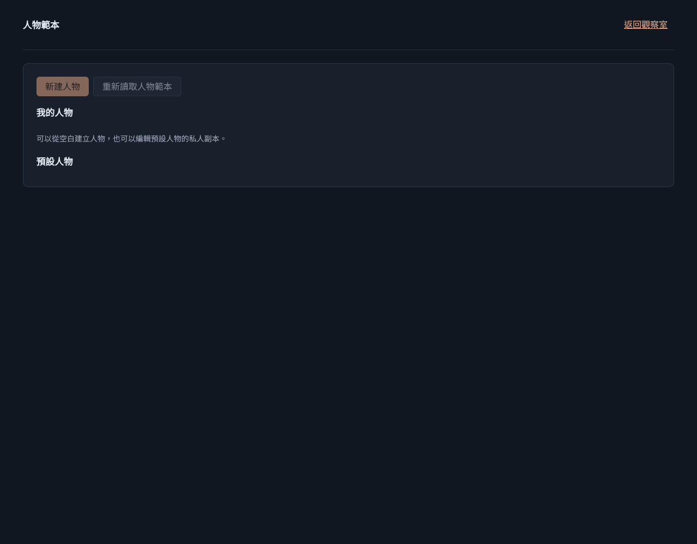
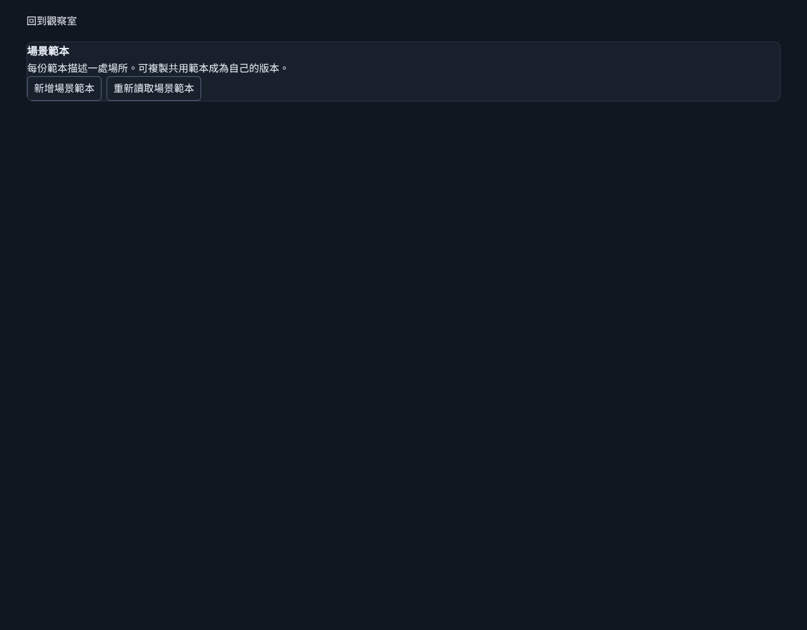

# #282 人物／場景真實導覽查證

狀態：**本機有效試次通過；正式站未完成有效試次，#282 保留未完成。** 沒有重現可定位的產品根因，沒有提交未知根因修復。

## 基線與範圍

- 開始點為 integration/start-game-281 的 `249f20c3723d46f1ad7ce3d5ace11be6d575697e`，與當時遠端 main 一致。獨立分支 `feat/navigation-evidence-282`。
- 已讀 #281、#282 最新本文及留言快照；原生 blocked-by 為空。#282 記載同提交的既有本機真路由兩次通過，以及正式登入後人物點擊被接管中斷、場景未點擊；本次不把那些未完成試次補記為成功。
- 本 clone 沒有 #281 引用的未提交導覽報告、grill 文件或 ADR0013–0017。搜尋 `rg --files docs` 確認其未隨此 clone 提供，並沿票面記載的基線；不聲稱讀過不存在的文件。現有詞彙表、專案代理規範與 ADR0003、0004、0012 等已讀。
- 本次本機是新雲端執行環境的重核證據，不能取代正式站原本尚未涵蓋的條件，也不是發現新的產品缺陷。

## 本機有效試次

執行於 2026-11-09 20:05 台北時間。origin `http://127.0.0.1:5282`，頁面建置版本 `249f20c`；完整時間、URL、標題在 [機器紀錄](assets/navigation-282/local-evidence.json)。文件標題皆為 `Quiet Hours · NPC 觀察室`，各頁 h1 如下。

| 首頁實際連結 | 到頁 URL | h1 | 重新載入 | 產品返回連結／瀏覽器返回 |
| --- | --- | --- | --- | --- |
| 人物範本 | `/character-templates` | 人物範本 | 同 URL 與標題 | 都回 `/` |
| 場景範本 | `/scene-templates` | 場景範本 | 同 URL 與標題 | 都回 `/` |

每條都從真正首頁的 `範本管理` 導覽取得連結再點擊，不是直接進入隔離編輯器。先確認未登入的真正首頁顯示「登入你的觀察室」，再使用明示的本機 cookie 身分替身，並非真人 GitHub OAuth。無瀏覽器 pageerror；模型呼叫 0、產品 POST 0。產品原有 GET 可能初始化本機世界，本報告不將 POST 0 說成資料庫零寫入。





命令（exit 0）：

```sh
PLAYWRIGHT_MODULE=/tmp/quiet-hours-browser/node_modules/playwright \
CHROMIUM_MODULE=/tmp/quiet-hours-browser/node_modules/@sparticuz/chromium/build/index.js \
node tooling/verification/browser-navigation-282.mjs
```

可重用工具為 `tooling/verification/real-route-runtime.mjs` 的 `startApp({root, port, databasePath, modelResponder})`。真正 vinext App Router、app 頁面、產品 API、來源 SQL migration 與磁碟 SQLite 執行；沒有替換頁面或 API、沒有安裝世界 fixture、沒有測試專用產品路由。只替換 auth、D1 hosting 與 model HTTP transport 邊界；呼叫者用 `qh_local_owner` cookie 選隔離身分。D1 batch 使用 SQLite transaction。指定外部 `databasePath` 時保留該 DB，跨同路徑重啟的本機測試加密值一致；固定 port 以保持模型 Key 的站點 scope。測試 Key 不得使用真實憑證。

未設定受控模型回覆時 fail closed；模型 adapter 的 HTTP 派送只到 loopback relay，另載入既有 no-network 預載攔截器，禁止外部 fetch。前端亦限制同 origin。這是本機 hosting／transport 的證據，不能冒充 workerd 或真實模型語義驗收。

工具準備過程曾因舊 Chromium 模組路徑不存在、auth alias 未涵蓋解析後路徑、尚未完成首頁載入就重載造成 dynamic-import aborted，以及 Vite 自訂 cache 的 dependency 解析而失敗。已修正工具並重新跑完整試次；這些失敗不能當作正式站按鈕失效的重現。最終使用各執行個體專屬的 node_modules 下 cache，避免平行執行共用預打包內容；close 只清自己建立的暫存目錄。

## 正式站阻擋

來源 origin 經 `wrangler.jsonc` 與 README 確認為 `https://quiet-hours-npc.houmengkou.workers.dev`。本次環境沒有已觀測的真人登入，尚未取得正式站版本、首頁標題、到頁或返回的有效證據。

1. 雲端 Chrome 的 `createBrowserTab` 回報 `Browser Use could not read requirements`。後續 inventory 只見 New Tab 與 about:blank，不能假定正式站已開啟。
2. Sky 原生桌面截圖確認停在 New Tab。嘗試輸入 origin 時回報 `AT-SPI provider with process ID 1808 is unavailable for X11 window 29360131`；並未完成正式導覽。CUA 流程已用 completion_summary 結束。
3. 2026-11-09 19:58:41 台北時間，以繼承代理設定進行唯讀連線診斷：

   ```sh
   curl --max-time 20 -I https://quiet-hours-npc.houmengkou.workers.dev
   ```

   回覆 `HTTP/1.1 403 Forbidden`、`server: envoy`、`curl: (56) CONNECT tunnel failed, response 403`。此 host 不在目前環境 allowlist。這是環境代理拒絕，不能歸因產品。

因此人物與場景的正式唯讀試次均仍未完成。解除環境連線與真人登入條件後，須各自從真正首頁完成點擊、URL／標題、重載與返回；不能由本機通過補齊。

## 驗收矩陣與限制

| #282 條件 | 結果 |
| --- | --- |
| 讀既有基線、分開本機替身與真人登入 | 已核對票面；未提交原報告在 clone 缺失已明示 |
| origin、版本、登入條件、連結、前後 URL 與標題 | 本機完整；正式未取得有效資料 |
| 正式完整有效試次，不把工具中斷判產品失敗 | 尚未完成，保留阻擋 |
| 重現才修根因；未重現不宣稱修復 | 無可定位產品重現；未改產品程式 |
| 真路由、正式不操作模型或世界變更 | 本機真路由；正式無有效頁面操作，未呼叫模型／推進／保存／重置／刪除 |

本票新增的是驗收工具與證據，沒有產品 schema／migration 變更，沒有正式資料遷移或部署。後續整合分支仍須重核導覽變更；本機證據不代表 #281 完成。
