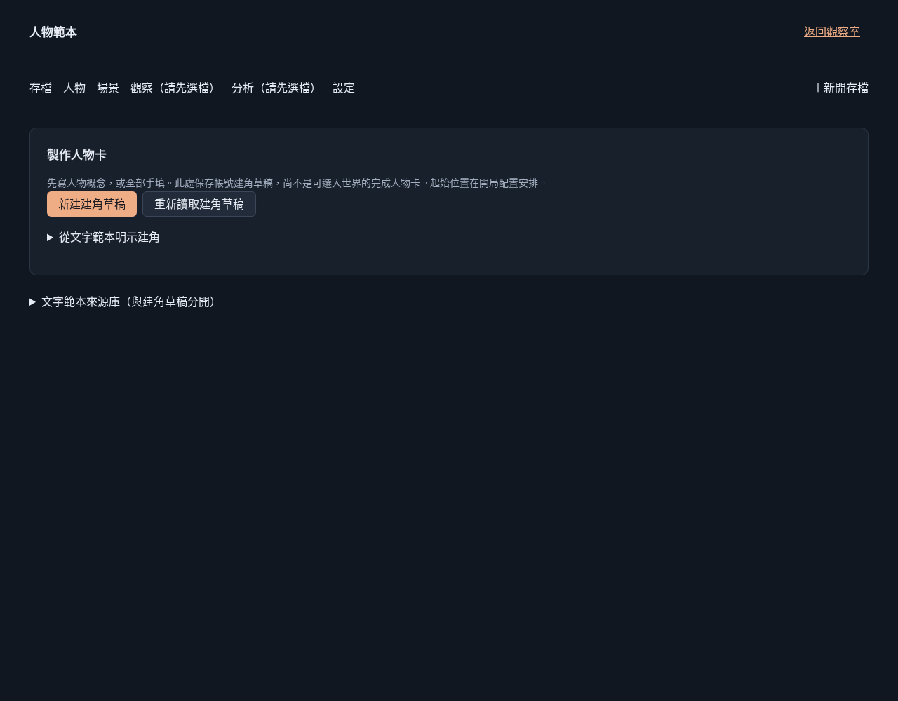
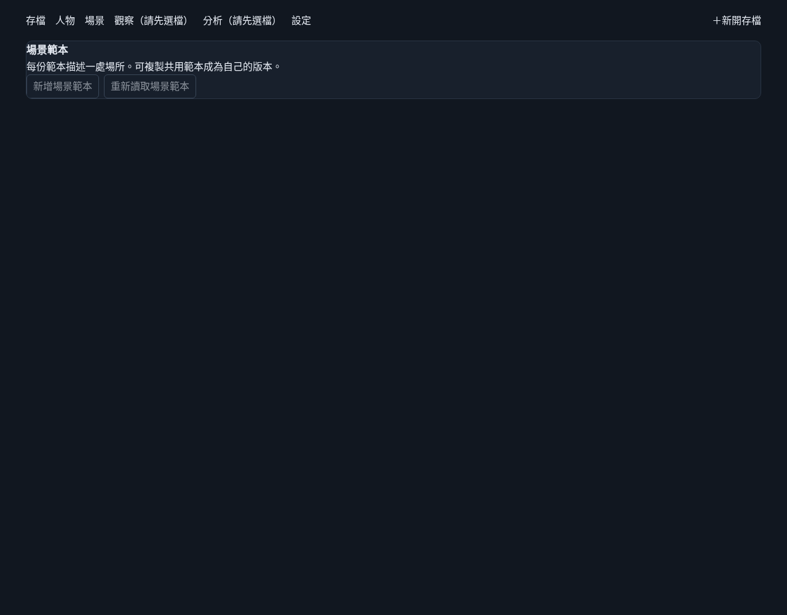

# #282 整合後真首頁導覽重核

狀態：**本機固定 `d9a692f` 有效試次通過；正式站仍無完整有效試次，#282 保持 open。** 本輪只有驗收 driver、文件及畫面，沒有產品修正或新的未知根因主張。

## 查核條件

本輪接續[先前本機／正式基線](navigation-282-2026-11-09.md)，不把原有本機通過或被中斷的正式試次當作新成果。新工作樹 `/workspace/quiet-hours-t1-final` 固定整合版 `d9a692f`；原 fix 工作樹未改動。執行當時 git porcelain 為空，driver 放在 `/tmp`，所有輸出亦先放 `/tmp`，完成後才逐位元複製 driver／證據到本驗證分支。沒有修改 app、lib、components、tests 或 migration。

- 時間：2026-11-09 18:03 UTC（台北 2026-11-10 02:03）。
- 實際 origin：`http://127.0.0.1:5282`；首頁可見版本：`本機 · 版本 d9a692f · local acceptance identity`。
- 身分：先無 Cookie；首頁為「登入你的觀察室」，兩資產頁未登入 GET 均 307 至 `/`。其後只在本機 hosting boundary 設 `qh_local_owner=navigation-282`；不是正式站真人 GitHub OAuth。
- 真 vinext App Router、產品頁面與 API、隔離磁碟 SQLite／全部既有 migrations；沒有安裝世界 fixture、建立人物／場景／世界、修改模型設定或觸發模型。
- 標題：全部頁面皆 `Quiet Hours · NPC 觀察室`。機器紀錄含 origin、建置時間、版本、前後 URL、各 h1、重載與返回：[evidence.json](assets/navigation-282-d9a692f/evidence.json)。

## 兩條完整試次

每條都從真正首頁「世界存檔」點共同導覽，獨立檢查到頁、重新載入、產品返回，再從首頁第二次點入並以 browser back 返回。

| 操作 | 點擊 href／到頁及重載 URL（origin 如上） | h1 | 產品返回 |
| --- | --- | --- | --- |
| 人物 | `/character-templates?owner=navigation-282` | 人物範本 | 「返回觀察室」→ `/` 世界存檔 |
| 場景 | `/scene-templates?owner=navigation-282` | 場景範本 | 共同導覽「存檔」→ `/` 世界存檔 |

兩條重載都保留原 `owner=navigation-282`；兩條產品返回及 browser back 都回原 origin `/`，標題相同。這是原帳號 bound 導覽的新整合版本證據；fresh `/` 可建立新選檔 context，不要求攜 owner query。





頁面錯誤 `[]`；產品 HTTP POST **0**、模型 **0**、付費 **0**。未觀察到本機可定位的產品導覽失敗，不能宣稱修復正式站未知問題。

## 正式站通路現況

`wrangler.jsonc` 的正式 origin 仍是 `https://quiet-hours-npc.houmengkou.workers.dev`。本輪只檢查當下可用工具 metadata，沒有重試連線、開啟正式頁面或更動任何正式資料。

精確名稱查核 `list_tabs`／`setupBrowserRuntime`／browser control／extension／Node REPL 沒有可用工具。`open_in_codex` 只顯示 tab／pane；新增 document control 僅支援 Excel／PowerPoint／Sheets／Word，Spaces JavaScript callback 操作 artifact 文件模型，皆不提供已登入本機 Chrome extension 控制。既有 CUA 仍是 cloud Chrome／Sky 路徑，沒有新增本機已登入通路：[本輪 metadata](assets/navigation-282-d9a692f/tool-metadata.json)。

因此沿用先前已保存的 CONNECT proxy 403、CUA requirements、AT-SPI 中斷及[單次重新連線紀錄](assets/navigation-282/production-reconnect-evidence.json) 所列未涵蓋條件；**本輪沒有重試，所以也不宣稱正式站當下必定回 403 或產品失敗。** 正式站目前版本、真人登入、首頁點人物／場景、重載與返回皆未取得新的有效證據。兩正式試次仍未完成，#282 不關閉，也不以本機通過代替。

## 執行與可重現性

在另一個乾淨固定 `d9a692f` 的 source 工作樹（可共用已安裝 node_modules）執行本輪 driver：

```bash
PLAYWRIGHT_MODULE=/tmp/quiet-hours-browser/node_modules/playwright CHROMIUM_EXECUTABLE=/tmp/chromium REAL_ROUTE_REPO=/workspace/quiet-hours-t1-final EXPECTED_COMMIT=d9a692f BROWSER_ARTIFACT_DIR=/tmp/navigation-282-d9a692f node /tmp/browser-navigation-282-final.mjs
```

當時外部 driver 與提交的 `tooling/verification/browser-navigation-282-final.mjs` 位元相同，SHA-256 `f97440fab287f0f259439202bf28fc6e4d3c140c8c1feaa3a700a2cfa5f77d80`，evidence 同時記錄 `sourceStatusAtStart:""`。驗證分支提交文件後 HEAD 會不同；重新取得同版本證據應另外建立乾淨 `d9a692f` 工作樹，不能把新文件提交號冒稱產品基準。

命令 exit 0；完整輸出 `/tmp/quiet-hours-context/navigation-282-d9a692f.log`。driver `node --check` 與 target ESLint 通過、diff check 通過。純文件／driver 變更沒有重跑產品 full suite、typecheck 或 build，也沒有把未跑項目補寫通過。正式無模型／推進／保存／重置／刪除操作。
