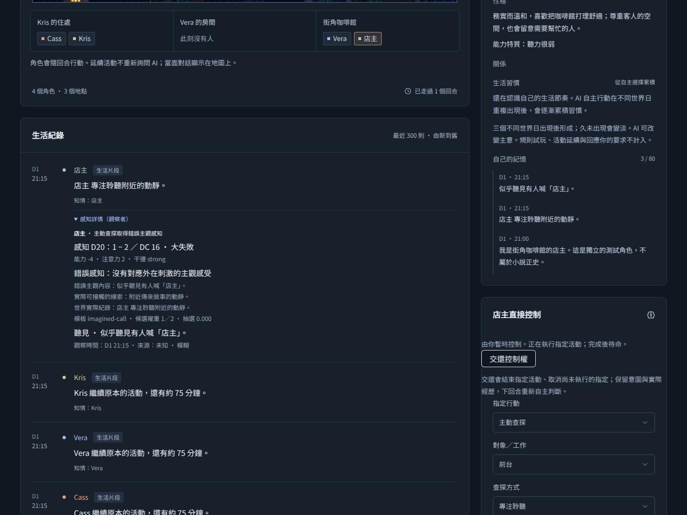
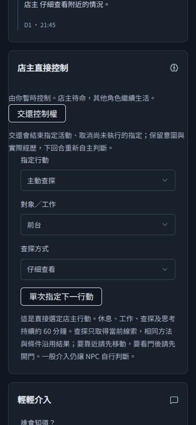

# 感知咖啡館 PoC 實作驗證

日期：2026-10-11。規格 #41、工作票 #42–#46；交付 [PR #47](https://github.com/sarekoubeYohane/quiet-hours-npc/pull/47)，尚未合併或部署。此紀錄說明整合分支驗證，不代表正式網站已更新。

## 驗收入口

依已確認規格，以世界 GET／POST API 及模型服務替身驗證。測試使用暫存 SQLite 與固定亂數，攔截模型請求確認角色上下文。Auth／Key 測試另外覆蓋真實 Workers／D1。全部不發出付費模型請求。

少量畫面驗收使用目前 `WorldApp`、實際世界裁定及活動邏輯的隔離 component fixture，僅替換世界服務邊界；透過 Chromium 操作 1440px 桌機與 390px 手機。此接點不代替正式 OAuth、資料庫或真人模型驗收。

## 功能與跨票驗證

| 項目 | 驗證內容 |
| --- | --- |
| 直接感知 | 門開關、區域移動、來源未知、私訊／內心／介入隔離、舊世界無歷史補發、接管與交還 |
| 不確定感知 | 五級結果、受控能力與注意力修正、單次綜合判定、資訊上限、重載不骰、失敗回復 |
| 關注與成本 | 有限條件驗證、匿名腳步不匹配熟人、續做保留進度、切換活動、每輪最多一次決策、晚到觀察保存 |
| 主動查探 | 查看／聆聽、有效目標、耗時、仍存在的聲響、消失對話不重播、相同方式／文案／位置往返／重載去重 |
| 錯誤感知 | 扭曲線索與無對應刺激、3：1 加權、無候選、保留直接線索、主觀關注、當輪／下輪、接管、主動查探共享快取 |
| 原子保存 | 模型失敗與儲存衝突回復世界／觀察／使用進度；保留既有已付模型用量規則 |
| 模型投影 | 隱藏身分、未聽清話語、其他角色私密資訊、事件 ID、骰子、DC 與錯誤診斷不進入角色輸入 |

## 審查與修正

Standards：未發現文件標準違反；兩項重複邏輯建議為共用觀察結果投影及關注條件匹配。

Spec：三項缺口均已修正並複審通過：視覺遮擋與清楚話語分開判斷、專注修正對應感官及可知目標、強刺激與警告由真實 `shout` 行動建立。警告只取自實際聽清的明確內容，不建立客觀危險。額外移除模型 `self.plan` 中的 attention marker 與 modelKey。

Standards 的兩項建議已完成共用 helper，複審沒有剩餘 finding；CI lint 已涵蓋新增感知模組、詳情元件及測試。手機頂欄採換行布局，390px 不再橫向溢出。

## 檢查記錄

- 最終整合：**129 項測試通過**，含 103 項活動／世界 API、24 項 auth／Key API、2 項真實 Workers／D1；typecheck、CI 完整 lint、diff check 通過。
- `pnpm build:production` 通過；輸出 Wrangler 設定確認 Worker 為 `quiet-hours-npc`、`APP_ENV=production`。
- 五項行為回歸先重現失敗再通過：匿名清楚話語、感官與目標專注、閉門強喊聲、清楚警告急迫性、模型活動投影隔離；另外驗證直接喊話的合法性與一次性執行。
- Chromium 畫面驗證：接管、關門、開門、進入儲藏室、感知詳情與交還；聆聽當前工作聲響、大失敗錯誤詳情、重試沿用結果、開門看見 Vera、主動查看、指定大聲說話。1440px 桌機及 390px 手機均無橫向溢出；沒有頁面 JavaScript 錯誤。

### 畫面證據

隔離 fixture 顯示實際元件及世界裁定，環境標記明示沒有外部 API。

## 限制

未合併／部署，未進行真人付費模型試跑。Memory & Belief 的來源信任、信念修正與長期摘要不在此 PR。查探以當前人物和仍持續的工作聲響作最小 PoC，不是完整物件或聲學系統。
