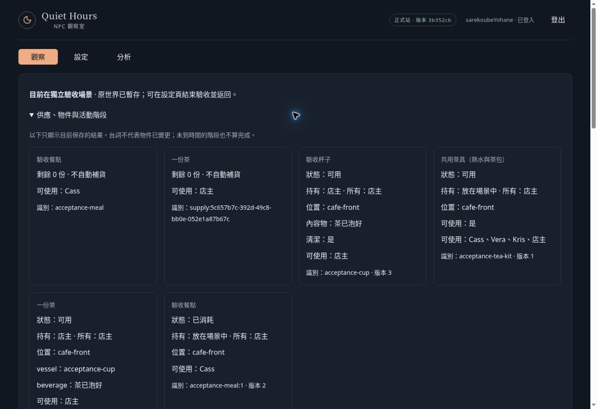

# NPC觀察室正式站最小驗收：部分通過

日期：2026-10-21（台北）。部署：production 3b352cb，建置 17:06。最近已合併 #131、#130、#142、#140、#135、#132；本次功能重點為 #131 活動生命週期／結果分支、#140 操作證據。

## 實際執行

正常結束舊隔離場景並返回原世界 21:00，再進入新 daily-life-v1，原世界暫存。起點第0回合 12:00，無日常規則、空杯。NPC OpenAI gpt-6-luna，裁定 gpt-6.1-sol，沿用已保存 Key 及玩家預算，未更改 Key。自動始終暫停。

兩個真實模型回合推進至 12:30／turn 2。第1回合4 NPC＋3裁定；第2回合3 NPC＋3裁定。合計13次、輸入84,333＋輸出3,235＝87,568 tokens。NPC已知價格小計 USD 0.00313794；6次裁定缺價格，總成本未知。

## 已通過

- Cass 餐點：裁定原始20分鐘，向上對齊30分鐘；12:15仍在活動，12:30完成。供應1→0；acceptance-meal:1 lifecycle=consumed、revision=2。延續活動少一次NPC決策。
- 店主首次泡茶：正常介入後自主提出原長句「我想用這套共用茶具取熱水和茶包，替自己泡一杯普通的茶。」target=acceptance-tea-kit。accepted，completionMinutes=null、effects=[]、stages=[]、check=null；v2六項timings原值5/5/10/5/5/1分鐘，保存均15分鐘。
- 保存6項v2 programs；acceptance-cup原ID沿用、revision=3、holder=owner、contents=tea；獨立飲品存在，vessel=acceptance-cup；店主plan=null。
- API GET已定案證據與UI證據逐字一致。第1回合原ID重送證據相同、呼叫7次及時間不變。第2回合重送後API比較version、objects、routineRules、events、aiUsage、operation evidence全部相同。
- UI重新載入後仍為12:30、2回合、13次呼叫；餐點已消耗、杯與茶成果保持。重新載入後決策模式回到規則試玩，未再推進。

## 未通過完整驗收的界線

- 原驗收杯contents只允許empty/water/tea；保存的drink程序會寫dirty。場景能力不足，未執行喝→洗→再泡茶，不擅加狀態或修改正式資料庫。免費日常重用未驗證。
- 借杯→攜帶→洗淨→歸還、跨回合泡茶中斷、五段結果／失敗消耗／部分成果未取得本次正式模型證據。首次泡茶只需15分鐘，不能當成跨回合中斷驗收。
- operation evidence明示truncated；新branches／programs未完整投影，不能把保存程序當成完整原始候選。此為#131已列限制。
- Vera兩回合以茶具提出泡茶均unsupported；Kris兩回合要求未授權餐點均denied。沒有越權效果，但是否構成持續行為循環尚需獨立驗證，不能以兩回合直接下根因結論。

結論：餐點取得／食用、首次v2日常泡茶、持久化及同ID重送通過；完整最小日常生命周期仍未完成。正式站未觀察到502或保存回滾。停在隔離場景12:30，原世界仍暫存，自動暫停，便於檢查。沒有修改程式、合併或部署。

## 篩選證據與成果畫面

僅保留本次操作證據、必要物件／規則；不包含Key、Cookie、operationScope或原世界備份。

[API 操作與必要世界資料](assets/pr131-live-acceptance/evidence.json)

