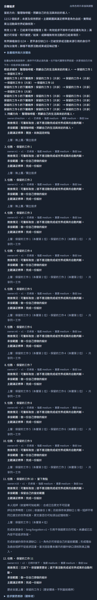
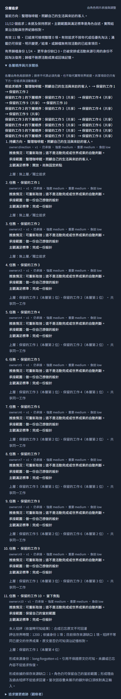
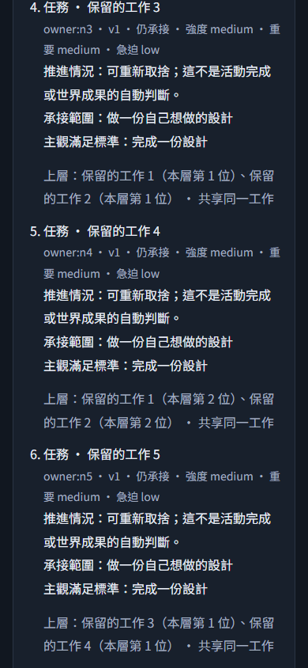

# #227 滿載／遺忘／一致維護驗證

範圍是受控程式驗收，使用世界 API、真活動／感知／效果、隔離 SQLite 保存重讀、下一次實際 provider request/messages 與既有角色／分析畫面。所有 provider 回覆均為 fixture，真實付費模型呼叫為 0，沒有推進正式世界；#220／#229 真實多輪行為仍未驗收。

## Red → green

既有 `memory-selection-contract-api` 壓力原本量出完整 body 169685 bytes，超出原 164000。保留 80 個嚴格來源配對、128 字身份、安全整數版本及 58 筆長記憶，修正後完整 body 162344 bytes，通過原上限，沒有改測試閾值。原 flexible-life 正常完整 input 91724 bytes；回憶 input 89309 加依據安排 811 會超過 90112，原程式漏掉安排。保留 458 字經歷與既有來源斷言，正常及回憶共同預留完整資料後兩者通過，回憶來源所支持的安排確實展示。

## 自動化與量測

`tests/pursuit-capacity-api.test.cjs` 的 14 個世界 API 旅程涵蓋：

- 精確 12 KiB／12 節點／16 邊／4 層與最大記憶來源並存；保留完整圖與保存資料。
- 精確滿額 keep→drop→archive；只整理明示結束資料，不 FIFO 淘汰 active。
- 父子同批歸檔兩排列等價；有保留中下層、非法來源、過期版本／身份仍拒絕。
- 24 個長 CJK 身份、16 個保存安排與暫停活動 origin；受引用身份不能淘汰／同名復活，歸檔 8 KiB 有界且缺口明示。
- 形成來源遺忘／評估原文／私有理由不進下一真正 messages，保留本人當前 scope 並展示來源缺口。
- 四角色各精確滿圖、四候選、同時兩 cue、局部重排與跨層退出（兩共享下層轉接、上層放下，共四更新）；四個原決策呼叫，`max_completion_tokens=2048`。input bytes 為 18399／19131／19901／20665，完整 body 為 70664／71764／72904／74038，回覆 JSON 2757／2740／2740／2740 bytes；保存世界 134926 bytes。原 work policy 400000 ms 未變，非新增等待或放寬期限。
- 純活動進度新增決策 0；成功／失敗原 ID 重送新增派送 0；後角色非法、CAS、提交前故障、租約失效回復圖、順序、cue、活動與世界，保留已知用量；控制接管／返回不預先消耗 cue。

七票 native 回歸加本票 13 例共 144/144。之後再補引號／反斜線短期來源反例，仍維持原 input／body 上限及完整圖。最後本票 14 例加 memory-selection-contract／flexible-life 共 27/27。引號／反斜線案例保存 80 短期來源，真正展示 62 筆、明示 gap 18；完整 input 60229 bytes、body 163860 bytes，兩個真安排 cue 保留並只處理一次，下一純進度不新增決策。`pnpm typecheck` 通過；`pnpm lint` 無 error，保留原有四項 img／hook warning。跨角色／scope／隱藏 A/B 與候選 byte/count 反例沿同一輪 T1–T6 native 回歸，不以私 helper 替代派送驗證。

## 畫面核對

執行 `tooling/verification/browser-pursuit-capacity-227.mjs`：真 WorldApp、世界 API、隔離 SQLite，先保存放下，再歸檔，兩次 fixture 呼叫、0 真實付費。重載確認滿圖、來源缺口、12→11 節點、歸檔 1/24；390px 無橫向溢位、無 page error、同 ID 無重送派送。畫面採可讀短文字滿圖，精確 byte 壓力由 API 測試承擔。

候選與正式承接差異、未提交結果的既有畫面證據另見 [#222](pursuit-selection-222.md)；本票不把觀察者 trace 或歸檔索引餵回 NPC。容量與有界歷史取捨見 [工程契約](../design/pursuit-capacity.md)。

## 母規格覆蓋接點

| 條目 | 本票證據 | 合併回歸接點 |
| --- | --- | --- |
| C16 | forgotten sources 真正 messages／來源缺口；來源省略後派生收尾 | flexible-life 真 recall／forget／安排與手機；T1–T6 隱藏／跨角色引用 |
| C17 | exact bytes、12／16／4、CJK archive、父子批次等價、滿載結束與整理 | T2 候選 5／UTF-8 超界，T3 第 13 節點／17 邊／第 5 層反例 |
| C18–C19 | 四種最大圖原子故障、成功失敗同 ID、SQLite／UI GET 重載 | 原 journal、usage、租約邊界回歸 |
| C20 | 最大圖 takeover／direct／return-control | T1 不同 context／NPC，recall 共享 payer 隔離 |
| C21／C29 | 四角色原四呼叫、四候選、四更新跨層退出、兩 cue，純進度 0 | T2 hidden A/B 真 messages 相同、原 recall／裁定界限 |
| C22／C30 | 滿圖／缺口／歸檔 desktop／mobile 真重載 | T2 候選／承接／未提交畫面與有界 observer trace |

此表是整合覆蓋的接點，不表示單一本票測試重現所有交叉組合；完整 C1–C30 對照與隔離多輪 runner 由 #228 統整。真實 L1–L5 行為仍另待 #229。

八組既有 memory-selection／recall／flexible-life／phone-memos／phone-calendar／phone-notifications／cognition／arrangement-cues 回歸共 103 例，初次 102 通過；唯一失敗是舊 synthetic 壓力不再足以省略 belief。保留原全部斷言並重建合法壓力，最新產品指定單一 case 重跑 1/1 通過：short 65461/65536 bytes、belief 16229/16384 bytes，20 個 short 全展示，完整 input 88246 bytes，24 belief 展示 22、可行整理後保存 23。此支援調整不削弱來源、維護或 88 KiB 斷言。
