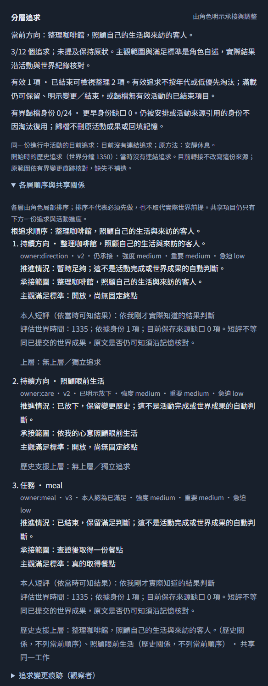

# #220 分層追求與同次發散：整合驗證

#221–#228 交付的是程式契約與隔離驗收準備。候選由正常LLM決策形成、同次自主收斂與選擇一步；下列受控provider回覆不代表真實NPC已改善，沒有真實付費派送、正式世界推進、合併或部署。#220與#229的行為證據仍未完成；#211原批保持原樣。

## 固定介面與證據

全部切片沿世界API → 真活動／感知／效果 → SQLite保存重讀 → 下一次真正provider request/messages → 既有WorldApp角色／分析畫面。T1–T7 使用隔離SQLite adapter；T8另外建立實體檔案SQLite，關閉runtime再重新開檔讀原ID，並把首組只讀副本接到原WorldApp重載。只替換transport、host bindings/auth及必要外部故障／時鐘，不替換追求或活動邏輯。

T8首組連續8輪結合：兩候選承接／共享下層 → 詢問與真正Cass答覆 → 等待 → 探索裁定 → 已知替代備餐方法 → 實際材料消耗和一份餐點 → 下一次輸入的各層滿足／方向暫時足夠 → 額外方向明示退出。未選候選與世界成果分開；方法更換保留同一追求／scope，活動只有一份進度。原件在本機私有有界目錄；公開畫面與摘要在[runner畫面](assets/pursuit-runner-228/summary.json)。

## C1–C30 覆蓋對照

表中測試皆透過世界API與實際派送。畫面列指向已保存重載驗證；缺口／不同證據狀態不由fixture補為真實改善。

| 驗收 | 程式／SQLite／下一次真正request證據 | 畫面／報告 |
| --- | --- | --- |
| C1 形成保存 | `pursuits-api.test.cjs`，T8共享承接／fileSQLite | [T1](layered-pursuits-221.md)、T8上圖 |
| C2 方向演化 | `pursuits-api.test.cjs`方向新增／修訂／放下，下一input不重注seed | T1、[T5](pursuit-exit-225.md) |
| C3 臨時與逐步形成 | `pursuits-api`無上層；`pursuit-graph-api`不同深淺 | [T3](layered-pursuits-223.md) |
| C4 共享下層 | `pursuit-graph-api`共享活動；T8兩方向共用meal | T3、T8 |
| C5 圖版本反例 | `pursuit-graph-api`循環／外來／過期／排列等價 | T3 |
| C6 跨分支排序 | `pursuit-graph-api`局部重排、重要根等待時跨分支 | T3 |
| C7 優先與前提 | `pursuit-graph-api`高優先不能跳物理前提 | T3、T8真備餐成果 |
| C8 省略保留 | `pursuits-api`空增量與局部變更；T8方法切換 | T1、T8 |
| C9 範圍／標準變更 | `pursuit-exit-api`縮小後滿足，兩段before/after保留 | T5 |
| C10 分層結果 | `pursuit-lifecycle-api`詢問／開始／成果／滿足；T8下一input評估 | [T4](pursuit-lifecycle-224.md)、T8 |
| C11 主觀外在分開 | `pursuit-lifecycle-api`可知誤信／主觀感受；自述不造物 | T4 |
| C12 持續方向 | `pursuit-lifecycle-api`enough保留不再造餐；T8後續休息 | T4、T8 |
| C13 上層退出 | `pursuit-exit-api`結束／轉接／獨立／共享及缺處置拒絕 | T5 |
| C14 活動承接 | `pursuit-lifecycle-api`continue；`pursuit-exit-api`pause/resume/abandon | T4、T5 |
| C15 再考慮 | `pursuit-arrangements-api`既有安排／一次機會／再次延期／睡眠 | [T6](pursuit-arrangements-226.md) |
| C16 來源遺忘 | `pursuit-capacity-api`來源缺口；`flexible-life-integration-api`真recall/forget | [T7](pursuit-capacity-227.md)、T6 |
| C17 容量維護 | `pursuit-capacity-api`12KiB/12nodes/16edges/4depth、archive與合法維護 | T7 |
| C18 原子故障 | `pursuit-capacity-api`較後角色／CAS／提交前／租約；T8 uncertain fileSQLite | T7、[T8 runner](pursuit-runner-228.md) |
| C19 重送讀取 | T1–T7成功失敗同ID零新派送；T8只原ID重開檔／RUN.lock拒絕重啟 | T7、T8只讀UI |
| C20 控制隔離 | T1跨NPC/context；T6接管／交還；T7滿圖控制 | T1、T6、T7 |
| C21 成本期限 | T7四角色原四slot／2048output／純進度0；T8 default payer及有限auth停止 | T7、T8 |
| C22 觀察介面 | T1–T7各slice重載；T8同fileSQLite原WorldApp／profile/390px | T8上圖 |
| C23 舊世界導入 | `pursuits-api`舊世界可讀、付費前409、真reset／用量；T8 trial重置不清payer | T1、T8 |
| C24 完整旅程 | `pursuit-runner-228.test.mjs`首組8輪全鏈、其餘窗口與payer連續；`demand-integration-api`真交付 | T8、[原#210](demand-integration-210-2026-10-28.md) |
| C25 同次發散收斂 | `pursuit-selection-api`多候選選一、正式增量、scope修訂 | [T2](pursuit-selection-222.md)、T8 |
| C26 未選與既有延續 | `pursuit-selection-api`空候選／焦點／等待／既有；T8等待與換方法 | T2、T8 |
| C27 選擇引用反例 | `pursuit-selection-api`不存在／重複／外來／選擇與增量矛盾 | T2 |
| C28 追求方法分離 | `pursuit-lifecycle-api`換方法同身份；T8探索→已知備餐，不把替代方法全承諾 | T4、T8 |
| C29 知情成本 | T2 hidden A/B實際messages；T7四角色滿圖／候選／bytes反例 | T2、T7 |
| C30 候選／結果分開 | T2空／未採用／未提交追溯；T7私trace不回灌；T8真world物件並列滿足 | T2、T7、T8 |

## 適用回歸與界線

整合 `ff68f64`（T1–T7產品及projection regression修正）完整預設套件：世界／活動1027/1027、auth32/32、Workers／D1 migrations／#211 checker15/15，合計1074項，0fail；世界組耗時723504ms。新增T8 runner測試另列指定執行，已接預設suite，避免把尚未包含的新測試算進上述1074。typecheck／build通過，lint保留4項既有warning。最終整合兩軸code review及修正由整合PR紀錄補足。

T8交付時 `node --test tooling/experiments/pursuit-runner-228.test.mjs` 為 **15/15通過、0fail（121693ms）**。正向完整批次為10個trial／80次advance、17次受控forward（含必要裁定）、64次非焦點partner fixture、81次原引擎計量；全為合成回覆，真正付費呼叫0。最大完整body106004bytes，沒有增加原輸出或期限。必要感知骰只於此受控positive固定`.675`；live的時鐘／骰與玩家限制不動。檔案SQLite原WorldApp重載、人物檔案、分析、390px、POST拒絕及GET世界不變均通過，公開摘要在上圖目錄。

T8正向完整80advance是**合成既有100calls／1,000,000tokens payer**的plumbing壓力，未改正式／原預設玩家上限。另以原12calls／30000tokens驗證合法首派送後到限停止，沒有set-budget、沒有trial刷新小時窗口。模型回覆、價目與授權均為測試fixture，不是官方價目或人類真實授權。

## #229 尚缺條件

獨立L1–L5各2次方案、固定8×15分鐘窗口與判讀在[新版預登記](pursuits-220-preregistration.md)。runner已可轉送真正焦點／裁定body，但沒有本輪人類有限付費授權；正式product/runner commit與適用account/tier價格仍待最終封存，也未讀取或探測真Key。官方模型文件已完成零派送來源預檢，私有原件hash與未封存價目metadata見新版預登記，不代表本批paid-ready。取得有效憑證、明確有限授權餘額／到期／payer scope、價格與停止來源後，才可另行執行#229。無真實成功鏈或退出分支時，#220與#229保持開啟；不自動關閉#211或其他既有問題。

## 最終review與修正

兩軸審查對`f9493c7...144bcea`提出Standards P3一項、Spec P1一項／P2兩項，均已在唯一review-fix分支處理，詳見[分軸修正與RED→GREEN證據](pursuits-220-review.md)。修正涵蓋歸檔用語、跨output持久payer／一次性授權、未提及與歷史綁定版、L5人工相關承接確認；另完成真官方price host allowlist反例與來源預檢。新增5個API旅程與3個runner反例接入預設套件；runner獨立第四組執行，避免source-pin反例與Workers／migration讀取來源競態。末次必要測試數與原reviewer複核在修正報告及整合PR記錄，不能把舊版精確body量測冒稱新head實測。
