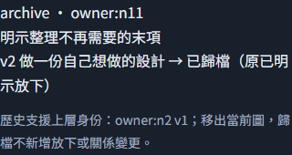
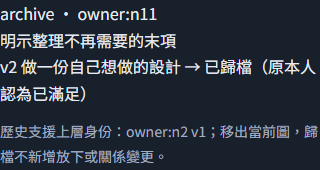
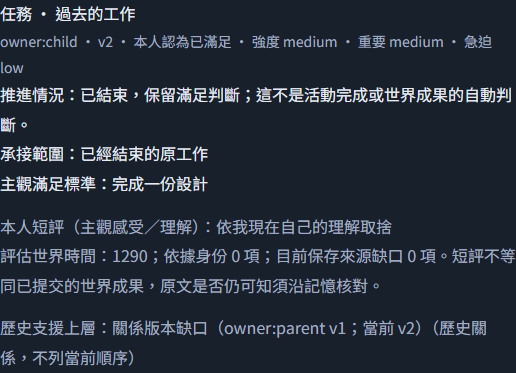

# #220 最終兩軸 review 修正

審查基準 `f9493c7...144bcea`。Standards初審提出1項P3，複查補充詞彙表工程細節1項P3；Spec初審提出P1一項／P2兩項，複查補充assessment綁定回歸及paired-ended新綁定逃逸各1項P2。以下分軸保存，不把程式fixture通過算成真實NPC行為證據。全部修正在同一review-fix分支，零真實模型派送、未讀真Key、未操作正式世界、main或部署。原兩位reviewer已對最終功能基準完成複查，結果見文末。

## Standards

**複查P3 詞彙表只保留領域定義。** 移除追求關係定義後的persist／version／驗證工程細節，使條目回到一個純領域定義句。最後明示綁定版本、當次有效父版與stale反例的技術契約完整留在`docs/design/layered-pursuits.md`及真正pursuitPrompt，沒有刪除或放寬程式檢查。

**P3 歸檔不等於再次放下或變為獨立。** 原畫面對只有before的archive顯示「→明示放下」「上層→獨立」，與詞彙表不符。現在依operation顯示「已歸檔（原已明示放下／原本人認為已滿足）」；沒有after不繪製after關係，保留原結束狀態與歷史上層身份。

既有`browser-pursuit-capacity-227.mjs`新增archive展開文字反例，先在真WorldApp重載重現RED，再修正為GREEN。已放下與已滿足兩種初始結束狀態各執行一次，皆兩次fixture呼叫、SQLite保存重載、390px、原ID零派送通過。

## Spec

**P1 換output不能重領同一有限授權或payer預算。** 原runner每個output新建payer SQLite且counter歸零，僅有目錄內RUN.lock。現在live固定使用private account.sqlite，SQL原子claim唯一runId及payer/授權reference，同payeractive／未明批次互斥；控制狀態先持久化同一account，再fsync／rename輸出副本。同一grant換output在讀Key／forward前拒絕；真正新grant仍共用原world row、小時窗口、累計用量、journal和玩家限制。一次性grant剩餘不自動重發。有效claim最多256筆，只釋放已到期且非active項，滿載停止；不靠淘汰有效grant取得額度。CLI沒有account位置override；測試只在controlled transport邊界注入temp account。

兩個實體SQLite／provider反例RED→GREEN：相同calls=1 grant換output不再forward，未明payer也拒絕新grant；不同新grant與output則保存同一payer，已用calls從2累計到4，原小時窗口與預設限制不變。只讀回原ID，不用reset／換ID補失敗。

**P2 未提及追求的歷史上層版本不可回寫。** 原全圖同步parents.version會在只改parent時修改child且不改其版本／trace。現在保存的是最後明示綁定版；僅本批upsert的關係解為端點保存版。未提及的active、satisfied、dropped節點及trace完整保留。重新upsert仍核對當次有效父版本，新parent=0仍解為新保存版本，不容許舊綁定版繞過stale檢查。實質改父範圍若下層仍active，須明示upsert其關係；僅assessment不能默認接受新版動機，結束下層則保留原歷史版本。

三種child狀態的世界API→SQLite→下一次真正request反例全部先RED；修後保留完整節點與child trace，後續明示重新綁定才自身v+1並保存before/after。另加active-child assessment不能默默承接父scope變更的拒絕例。畫面在歷史綁定版與當前父版不同時，顯示原id／版本與文字缺口，不能拿新版父內容充作舊工作動機；私有trace沒有進NPC輸入。

**複查P2 保留綁定後仍能正常評估進度。** 父priority升版、未提及active child保留原父版之後，原驗證錯把後續assess當新綁定而整輪拒絕。現在只有真正upsert才檢查當次父版本；assess的既有關係保留，實質父scope變更仍要求明示upsert或結束處置，沒有全面放寬關係驗證。新增waiting／deferred／known-result三條世界API→SQLite→真正下一派送旅程，皆先RED再GREEN；known-result引用當次真實可見記憶。每條也驗證新upsert若沿用舊父版仍拒絕且整輪不改，合法評估的before／after保留原父版。

**複查P2 同批結束不能跳過新綁定驗證。** 原先只驗最終active節點，upsert後同批assess satisfied能偷渡新關係。現在最終active與本輪upsert都驗端點、有效父版；循環／深度亦涵蓋本輪新綁定，即使本輪結束。未改的ended歷史保持原狀；原有效父同輪合法結束仍能保留歷史支援。七條最高API／SQLite／真正下一請求旅程包含stale、不存在、跨角色、雙節點皆同輪結束的循環、跨worldcontext拒絕，以及合法配對／父同輪退出兩正例；四種關係逃逸先RED再GREEN，跨context原有拒絕仍成立。拒絕時完整characters不變，下一次真正輸入仍承接原資料。

**P2 L5只在人工確認相關餐點承接後提供改變。** 原本任意active非direction工作都會觸發撤餐，無關整理也耗掉唯一機會。現在預登記採外部controller明確讀證據確認，綁run、trial、真正已提交operationId、pursuitId/version、相同scope與人工reference；不從職業、關鍵字或任意工作猜承接，不新增付費classifier。未確認／錯誤綁定保持not-reached，不消耗變化機會。

五輪真世界API／SQLite／下一派送旅程先RED：無關整理、資訊only、拒絕不撤餐；不存在身份、錯operation、過期version、scope不符都不觸發；其後真正餐點承接經明確controller確認，才由Cass的下一個正常say活動產生可知改變，再進焦點角色真正input，最後自主放下。controller只決定事前登記的partner台詞，沒有注入焦點追求／記憶或強制其退出；相關性仍是人工判讀責任，不冒稱機械語義驗證。

## 必要驗證與限制

原節點／邊／深度、四更新／8KiB、88KiB input、164000bytes完整provider body、輸出tokens、回合工作／租約與玩家政策均保留。加入最小prompt綁定說明後，80來源測得完整body162394bytes；quote-heavy完整圖與原80來源壓力保留，沒有放寬閾值、縮短來源或移除schema斷言。原T7文件中的精確量測是其記錄版本，不能當作本修正版的所有實測值。

前一功能提交`7b8f25b`已驗90項native與18項runner（121625ms）；下列為追加paired-ended修正`f2b6c07`的指定驗證：

| 檢查 | 實際結果 |
| --- | --- |
| `node --test tooling/experiments/pursuit-runner-228.test.mjs` | 18/18通過、0fail，115303ms；含跨output／新grant同payer及官方price host新反例 |
| review API＋graph＋exit＋lifecycle＋capacity＋memory-selection | 97/97通過、0fail，35865ms；含新增15個最高API旅程、原capacity14與memory-selection4 |
| 受控正向完整批次 | 10trial／80advance、17受控forward（含裁定）、64partner fixture、81原引擎用量；max完整body106004bytes，真付費0 |
| 原player policy | 原12calls／30000tokens可首forward並到限停止，沒有set-budget或刷新窗口；完整80advance另明示用合成既有100calls／1,000,000tokens payer |
| UI | archive dropped／satisfied各2次fixture、history版本差異3次fixture；真WorldApp／SQLite重載、文字缺口、390px及原ID零新增派送通過 |
| typecheck／本輪ESLint／diff check | 通過；沒有提高原輸出、期限或預算上限 |

原兩位reviewer已對固定功能基準`f2b6c07`完成最終複查：Standards原2項P3、Spec原1項P1及4項P2全部修正，共7項finding，0未解、0新增code smell。初審及中途複查歷史保留於上文，不把新修正覆寫成初審零問題。整合後完整預設回歸由整合PR記錄。預設suite把18項runner放在獨立第四組，先完成Workers／migration／#211 checker；source-pin反例不與其他來源讀取者並行。

#229仍未執行。2026-10-29只補官方模型文件來源預檢，公開去識別metadata含來源hash，完整原文留私有；Standard短context價目與其他tier條件尚未構成本批已封存適用價格。需要最終review版本／runner指紋、相關人工controller、實際account/tier、有限人類授權與有效憑證後才可另行派送；default仍未paid-ready。
