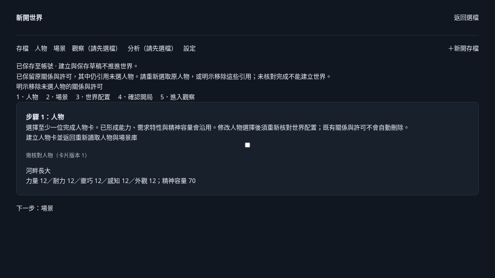
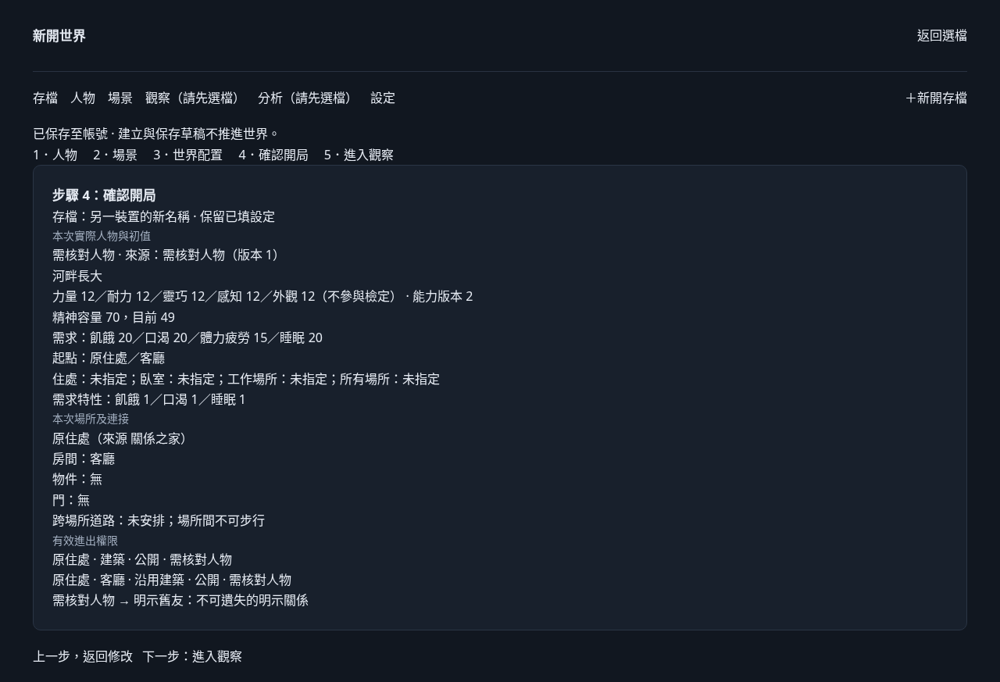

# 最終整合審查修正 #281

本輪從乾淨 `6ddae5b` 建立獨立 `fix/final-start-game-review-281` 工作樹；沒有修改 root 的完整回歸／build 工作樹，也沒有重做已獨立確認為 0 的早期問題。以下保留每個反例與修正後可觀察結果，不把舊全套或受控模型結果當作最終真實模型語義驗收。

## 採納草稿與收據原子性

兩軸獨立在原 `6ddae5b` 重現：只對 `opening_arrangements` 的 adopted UPDATE 注入 SQLite ABORT，POST 503，但開局草稿已 version 2／建議已套用、proposal 仍 complete；移除 trigger 後原採納請求回 409，無法恢復。原腳本與 log：`/tmp/standards-adoption-receipt-6dd.mjs`、`/tmp/quiet-hours-context/standards-adoption-receipt-6dd.log`、`/tmp/quiet-hours-final-adoption-atomic-spec.mjs`。新增永久 API／disk 測試先 RED：`final-adoption-atomic-red.log`。

`a3ada6c` 將草稿 CAS 與 proposal adopted／adoption_request 放進同一 D1 batch。SQL 同時約束原 owner／draft、草稿版本／未 finalized、proposal operation／revision／result／snapshot／request、最新可採納 row 與沒有 pending 整理。草稿的 last_request 使用原採納操作唯一標記，不能以「相同 city」或「較新版本」猜成功；只有同一操作已提交的 receipt 才能解釋重送時遇到的版本差異。

新增真產品 API／磁碟 SQLite 測試：

- before-write ABORT 與第二筆 receipt UPDATE ABORT：草稿及 proposal 原始 SQL row 完全不變，不留下半套狀態。
- 移除 fault，關閉及重新開啟同一 DB，原 request 200、草稿只 +1、proposal adopted；再重開及重送仍是同份草稿／同 receipt，不呼叫模型、不取新骰。
- 舊 proposal revision 409，兩原始 row 不變；兩個並送相同採納 request 都恢復同結果，草稿僅增加一次版本。
- 真 Chromium 另在後端已接受 200 後 abort 採納 HTTP 回覆，UI 只恢復原操作，再進確認與保存；沒有以「讀到相同 city」冒充 receipt，也沒有吞版本衝突。

原帳號／來源／pending／proposal 版本 guards 均保留。沒有 schema migration，沒有回補或重寫原已保存卡、骰、帳單或世界。

## 修改人物選擇不得默刪相依設定

原 `a3ada6c` 真頁 RED：取消再勾回同人物卡，兩次自存 200 後原明示 relationships／accessGrants 變空。原獨立腳本 `/tmp/quiet-hours-final-selection-dependencies-spec.mjs`，本樹 log `final-selection-dependencies-red.log`。

`d4b3428` 取消選擇只改人物名單，原關係／許可持續保存在開局草稿；仍引用未選人物時明示核對，無效引用不能建立世界。重新選取原卡不假稱恢復已刪資料：引用始終未刪，人物起點等配置仍須核對。若玩家決定不要這些引用，須點明確標示的 cleanup 按鈕；該按鈕沿用 pending／conflict／finalized 鎖，不會自動呼叫模型。

同類 removePlace audit 發現會連帶清掉已填引用，改為：若仍有起點、住處、工作、所有權、許可、空間或道路配置，明示「尚未移除」，完整 city 不變；先在既有配置流程明示核對或解除引用。沒有相依設定才移除空場所，不擴成自動重建場所／道路。

真頁永久 driver `browser-selection-dependencies-281.mjs`：取消→自存→重載仍有引用／警示、無效草稿直接確認 API 400；復選保留原引用；被引用場所移除被擋且 city 完全不變；另一裝置 CAS 409 保留本頁輸入／引用；重載重新核對起點後，確認並保存 turn 0，原卡值不變。第二份草稿只有在明示 cleanup 點擊後才清除引用。整條 controlled 1、paid 0。





## 比較數值語法與合法背景單位

原比較規則（`a3ada6c`／`d4b3428` 的形成程式相同）真 API／SQLite 新 RED：力量高於18／力量大於18／strength greater than 18 可形成，違反形成前禁止指定能力數字／範圍。這不是模型改骰；原受控實際力量仍 12，問題是違規文字被鎖定。

`1861ffd` 將偵測拆成屬性名稱、指定／範圍連接詞、比較運算語法類別、數字。中文形容比較族／超越逾及英文比較級加 than 共同處理，保留 must be／between／符號等既有規則，不跨任意背景文字找下一個數字。新 30 個非法例在形成前 400，模型／骰均 0；四個普通中文與年齡身高合法形成。

Standards 隨後真 API 確診 `strength greater than 18-year-olds` 被新比較語法誤擋，原 log `/tmp/standards-numeric-age-186-confirmed.log` 保留。這是新的合法背景回歸，不以原 30 例通過掩蓋。

`d1ddc36` 只讓既有年齡／物理單位例外可前接 Unicode 連字號。新 age 例先 RED 400，再 GREEN：18-year-old(s)、175-cm、80-kg、nonbreaking-hyphen 共五例 200 並保存原文；每例原 ID replay 同 draft、model／dice 不增。裸 greater than 18、原 30 非法及 18–20／18-20 範圍仍拒絕。沒有改動既成卡／已保存骰，沒有藉升版重抽。

## 固定證據與檢查

- `a3ada6c` AI opening API 完整 11/11，包括新第二筆寫入 rollback、disk reopen、CAS／並送去重；真頁採納回覆遺失完整旅程 controlled 2／paid 0。
- `d4b3428` 新人物相依設定真頁全部通過，controlled 1／paid 0；typecheck 通過。
- `1861ffd` 整合窄組（AI opening／opening／cards／drafts／models）58/58、typecheck、lint（0 errors／4 原有 warnings）與 build 通過。三真頁 AI 完整開局、人物引用、pending 恢復均通過，controlled 各 2／1／3、paid 0；[機器證據](assets/final-review-fixes-281/ai/evidence.json)、[引用證據](assets/final-review-fixes-281/dependencies/evidence.json)、[pending 證據](assets/final-review-fixes-281/pending/evidence.json)。這些 log 完成於 19:21–19:22 UTC，早於 age patch 的 19:24，不是混源宣稱。
- `d1ddc36` 人物卡 API 完整 12/12，含 30 非法、普通中文、背景單位與不增 model／dice 的 replay；typecheck 通過。最終整包固定窄組與必要工程 checks 如下。

兩軸已對每個固定修正獨立覆核：atomic、人物相依設定、原數值比較及新增 hyphenated-age 回歸目前各 remaining 0，Standards hard 0／judgment 0。Spec 另驗裸範圍拒絕、合法單位原文保存及 replay 不增骰／模型。此為已提出 findings 的結論，不代替新整合版本的完整 full suite。

原 `/tmp/quiet-hours-context/final-adoption-atomic-red.log`、`final-selection-dependencies-red.log`、`final-numeric-comparison-red.log`、`final-age-hyphen-red.log` 與兩軸原 log 均保留；一次寫 String.raw escape 的中間窄測失敗也沒有改寫原紀錄。root 原 `6ddae5b` full 1414/1414 及兩 build 已完成，但其來源尚未包含這些新反例／修正，不能併成新來源一次全綠。

本輪全部為隔離本機 API／SQLite／受控 transport；沒有付費、正式資料遷移、正式世界操作、push、merge main 或自行關票。真模型語義品質仍未驗收。原票 #282 正式唯讀導覽仍依既有工具阻擋證據保持未完成，沒有宣告整份 #281 完成。


## 最後交付版本檢查

固定 `d1ddc36`（含前三項及 age 相鄰回歸修正），以下全部 exit 0：

```bash
node --experimental-strip-types --test tests/ai-opening-arrangement.test.mjs tests/opening-wizard.test.mjs tests/character-cards.test.mjs tests/character-drafts.test.mjs tests/model-settings.test.mjs
pnpm typecheck
pnpm lint
pnpm build
```

API／實際 SQLite／disk reopen 整合窄組 **59/59**；lint 0 errors、4 個原有 warnings。原始結果分別在 `/tmp/quiet-hours-context/final-d1dd-narrow-suite.log`、`final-d1dd-typecheck.log`、`final-d1dd-lint.log`、`final-d1dd-build.log`。形成、採納、重播及衝突皆從產品 API 進入，沒有直接安裝世界的測試捷徑。

此後只整合最新 integration 的純紀錄並新增本文件／畫面；未改動產品來源。沒有新增 migration；採納使用既有 D1 batch 與欄位。回退程式不需要刪除或重算任何已存卡／骰／世界／帳單，但會重新暴露舊版已確診漏洞，不能把回退當作修復或正式資料回復步驟。root 將另以新固定整合版本執行完整現行套件與 build，不能把這份窄組及舊 full 合成一次新 full 通過。
